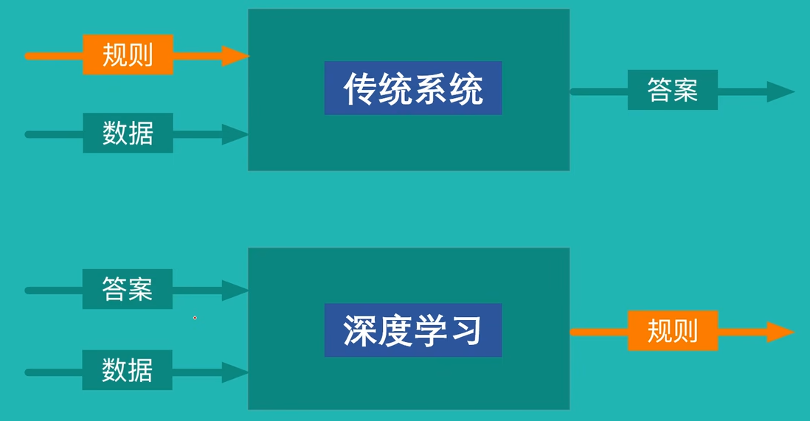
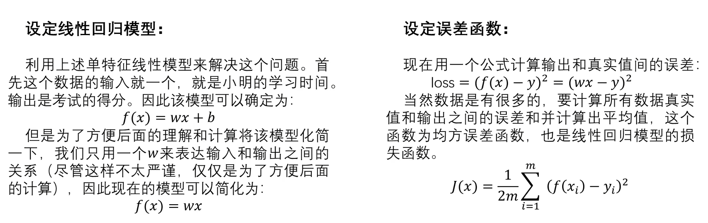
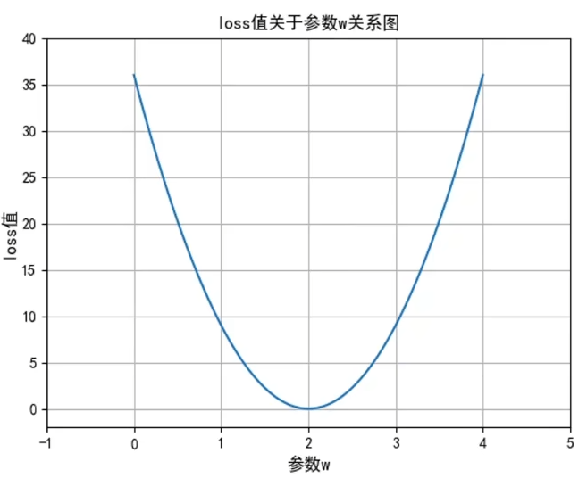
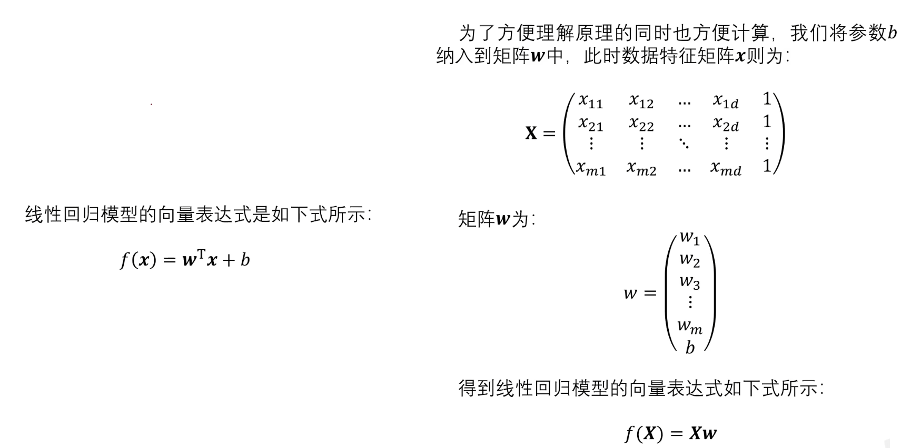
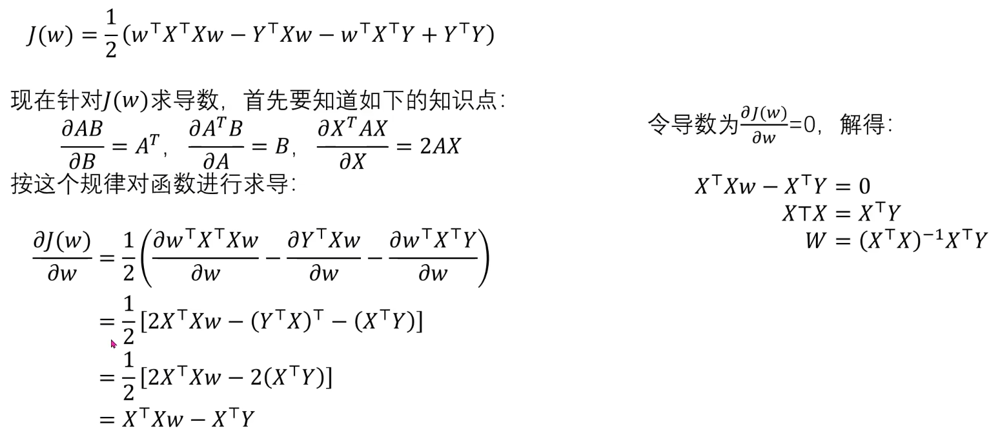

# 深度学习

过拟合（offerfitting）：机器学习模型在训练数据上表现很好(比如准确率极高)但在新数据(测试集或实际应用场景)上表现明显下降的现象

### 深度学习框架：Keras+TensorFlow

## 一.线性回归模型&梯度下降法
### 1.线性回归模型定义

> w~i~为权重参数；b为偏置值
> y~i~为已提供的目标属性样本值
> 实际可能会得到不止一组（**w**,b），那么需要计算和样本间的平均距离，选取损失最小的
### 2.误差函数

> 用于评判所得到的参数（**w**,b）
### 3.参数求解
#### 1).穷举
#### 2).最小二乘法
##### 非向量形式
二次函数求最小值

##### 向量形式

**----矩阵求导----**
 
> 但(X^T^X)^-1^可能无解，所以最小二乘法不一定可以求解
### 4，梯度下降法
