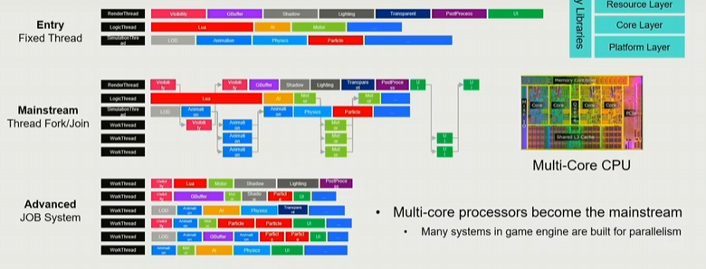
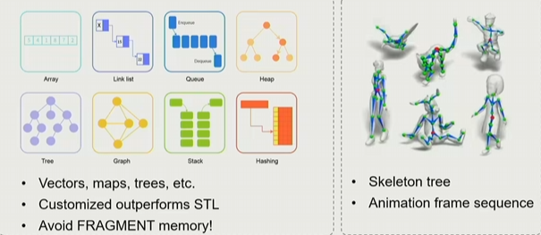
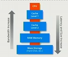

# Layered Architecture of GameEngine
## 一.游戏引擎层次概览（顶->下）
1. Tool Layer
   ``各种编辑器等``
2. Function Layer
   ``使得游戏世界能被看见、能动起来``
   ``物理、动画、脚本、AI、镜头、HUD、输入等``
3. Resource Layer
   ``数据、文件等``
4. Core Layer
   ``类似工具箱，提供内存管理、容器分配、数学运算等功能``
5. Platform Layer
   ``处理各种平台适配，包括OS、文件系统等``

## 二.Resource Layer——How to Access My Resource
### 1.Offline Resource Importing
``定义统一文件格式将资源(Resource)转化成资产(Asset)``
``通过预处理导入加速资产访问``
``构建复合资产文件引用所有资源(将不同资产文件进行关联)``
``利用GUID（全局唯一标识符）对资产进行标识，提供额外保护参考``
### 2.Runtime Asset Manager
``一个虚拟文件系统通过路径引用动态加载/卸载资产``
``通过Handle System管理资产生命周期``
### 3.Manage Asset Life Cycle
Life Cycle——Memory Management For Resources
``不同的资源有不同的生命周期``
``有限的内存要求在条件允许的情况下对已加载的资源进行释放``
``垃圾回收、延迟加载(玩到哪加载到哪)很重要``
## 三.Function Layer——How to Make the World Alive
### 1.Tick(时间单位)
1).TickLogic->逻辑：``I/O、算物理、动镜、角色移动、碰撞检测等``
2).TickRender->渲染：``画面裁剪、光照、阴影等``
3)在每一个Tick
``  获取角色的动画帧``
``  塑造角色的骨骼和皮肤结构``
``  渲染器在每一帧的渲染周期中对所有渲染任务进行处理``
### 2.Heavy-duty Hotchpotch
1)功能层为游戏引擎提供了主要的功能模块
``对象系统Object System（HUGE）``
2)游戏循环会定期更新各个系统。 
``游戏循环是理解游戏引擎代码的关键`` 
3)模糊引擎与游戏之间的界限 
``相机、角色与行为``
``为程序员设计可扩展的引擎接口``
### 3.Multi-Threading

## 四.Core Layer——Math Library
### 1.Math Efficiency
### 2.Data Structure and Containers

### 3.Memory Management
1).游戏引擎表现主要瓶颈
``Memory Pool/Allocator``
``Reduce cache miss``
``Memory alignment``
2).多形态内存资源（PMR）

``缓存局部性``
``缓存扩散(Cache Diffusion):生成式AI中加速扩散模型推理的技术``
``Memory Arena:一种高效的内存管理策略，核心思想是预先分配一大块连续内存（称为“Arena”），并在其内部统一管理对象的内存分配与释放。它通过减少内存碎片化、降低系统调用开销，显著提升程序性能``
**归根结底还是图灵机**
1. 把数据放在一起
2. 顺序访问数据
3. 按块分配和回收
### 4.Foundation of Game Engine
1. 核心层提供了各个功能模块所需的各种工具和功能
2. 需要卓越的高性能设计与实现
3. 高标准的编程
## 五.Platform——Target on Different Platform
1. 对不同平台的兼容性
2. 提供平台独立的服务和信息给上层
``掩盖不同平台的差异，使得在上层写代码可以无视平台区别，只专注于实现功能``
## 六.Allow Anyone to Create Game
