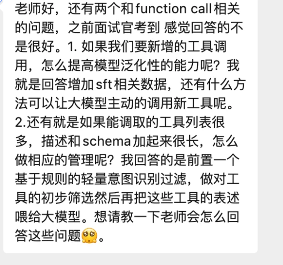

# 09. Function Call 工程化落地两大问题深度解析

今天有个同学问了下他面试中遇到的问题，是这样的：1. 如果我们要新增的工具调用，怎么提高模型泛化性的能力呢？2.还有就是如果能调取的工具列表很多，描述和schema加起来很长，怎么做相应的管理呢？

Function Calling 是大模型应用落地中最关键的能力之一了。今天围绕这两道 Function Call 相关问题，仔细讲讲。

### 问题一：新增工具时，如何提高模型的泛化调用能力？

这个问题的主要是解决这个问题：我们不可能每新增一个工具就重新训练一次模型，那如何让模型"认识"并主动调用它从未见过的工具？最直觉的回答是"增加 SFT 数据"，但这只是其中一个维度。一个完整的回答应该覆盖从零成本到重量级的多层方案。

#### 第一层：Prompt 工程——零成本，立竿见影

这是最容易被忽视但往往最重要的一层。模型能否泛化到新工具，很大程度上取决于你怎么写工具的 description 和 schema。关键原则是：工具的 name、description、参数名、参数描述都要尽量 语义化、自解释、贴近自然语言 。

举个例子，新增一个查天气的工具，参数名叫 loc 就不如叫 city\_name ；description 里写清楚"当用户询问某城市天气、温度、是否需要带伞时调用"——做好这一步，基座能力强的模型不需要任何额外训练就能正确调用新工具。

本质上，这是在利用模型的 in-context learning 能力，把工具描述当作 few-shot prompt 来精心设计。这一层投入产出比最高，面试时一定要先提。

#### 第二层：训练策略——不只是"加数据"，关键是怎么加

SFT 的方向没有错，但面试官想听到的是更深入的训练策略设计：

- 工具增强训练（Tool-Augmented SFT） ：训练数据中不要固定工具列表，而是每条样本随机组合不同数量、不同领域的工具。这样模型学到的是"从候选列表中理解语义并选择"这个 元能力 ，而不是记住特定的几个工具。

- 合成数据 + Self-Instruct ：用大模型批量生成新的工具定义和对应的调用样本，大幅扩展训练时的工具种类覆盖面。模型在训练阶段就见过大量"从未见过的工具"，泛化能力自然提升。

- 负样本训练 ：训练数据中一定要包含"不需要调用任何工具"的样本，避免模型养成对所有 query 都强行触发 function call 的坏习惯。这一点在实际落地中非常关键。

#### 第三层：检索增强——把工具发现转化为检索问题

当工具规模达到几十甚至上百个时，可以引入 Retrieval-Augmented Tool Selection 的思路：将所有工具的描述做 embedding 存入向量库，用户 query 进来后先检索最相关的 top-K 个工具，再拼进 prompt 交给大模型做最终选择和参数填充。

这个方案的优势在于：新增工具只需要把描述 embed 入库即可，完全不需要修改任何规则或重新训练模型。 本质上是把"新工具发现"这个问题转化成了一个检索问题 ，天然具备可扩展性。

|   层级   |   方案   |   成本   |   适用场景   |
| --- | --- | --- | --- |
|   Prompt 工程   |   语义化工具描述，利用 ICL 能力   |   零成本   |   所有场景，优先级最高   |
|   训练策略   |   随机工具组合 SFT + 合成数据 + 负样本   |   中等   |   需要系统性提升泛化能力   |
|   检索增强   |   工具描述向量化，query 检索 top-K 注入   |   较低   |   工具规模大、频繁新增   |

### 问题二：工具列表过多、描述过长，如何做工具管理？

当可调用的工具达到几十上百个，所有工具的 description 和 schema 拼起来可能占据数千甚至上万 token，直接全部塞进 prompt 既浪费算力又可能超出上下文窗口。这个问题考察的是你对大规模工具管理的工程化思考。

#### 方案一：多级漏斗架构

这是最经典的思路，核心是"粗筛 + 精排"两级流水线：

- 第一级（粗筛） ：用轻量级方法从全量工具中快速缩减候选范围。可以基于规则（关键词匹配、正则表达式）、小型分类模型或 embedding 相似度，将几百个工具缩减到 10-20 个候选。

- 第二级（精排） ：将粗筛后的工具完整描述拼入 LLM prompt，由大模型做最终的工具选择和参数填充。

这里有一个关键的工程细节： 粗筛层的召回率必须足够高，宁可多给不能漏掉 。因为一旦正确工具在粗筛阶段被过滤掉，大模型就完全没有机会选到它，这是不可逆的损失。

#### 方案二：工具描述分层组织

不一定非要过滤工具，也可以从减少单次 token 消耗的角度设计：

- 第一轮 ：给模型一个"工具目录"——每个工具只有 name 加一句话摘要。模型先选择类别或圈定候选工具。

- 第二轮 ：只加载被选中工具的完整 schema，让模型做最终决策和参数填充。

这是一种 two-stage progressive disclosure 策略，类似操作系统中的多级页表——只在真正需要时才加载详细信息。在工具描述特别长（比如每个工具有复杂的嵌套参数 schema）的场景下效果显著。

#### 方案三：基于检索的动态工具注入

这和问题一的第三层方案完全呼应：对所有工具描述做向量化，用户 query 进来后做语义检索取 top-K，只把最相关的工具注入当前 prompt。

这个方案的优势是双重的：既解决了 token 消耗问题，又对新增工具天然友好——新工具入库就能被发现，不需要维护任何规则或分类体系。

#### 方案四：微调内化工具知识

如果工具集相对稳定、变动不频繁，可以通过微调把工具知识直接内化到模型参数中。推理时只需要给出工具 name 或简短标识符，而不用在 prompt 里塞完整描述。

这个方案的 trade-off 很明确：推理效率最高，但每次新增或修改工具都需要重新训练。适合工具集固定的垂直场景（如企业内部固定业务系统的对接）。

|   方案   |   核心思路   |   优势   |   局限   |
| --- | --- | --- | --- |
|   多级漏斗   |   粗筛 + 精排两级流水线   |   成熟可靠，工程实现简单   |   粗筛层需保证高召回   |
|   分层组织   |   先选类别再加载详情   |   大幅减少单次 token 消耗   |   增加一轮推理延迟   |

### 面试回答建议

回答这类工程化问题时，建议按照 成本从低到高 的顺序组织答案：

1. 先说不需要训练的方案（Prompt 工程、检索增强）

2. 再说轻量训练方案（SFT 策略设计）

3. 最后说重量级方案（微调内化）

这样做的好处是：既展示了你对多种技术路线的了解，也让面试官感受到你对 成本、效果、落地难度 之间 trade-off 的判断力——这恰恰是高级工程师和普通工程师的分水岭。

同时注意，两个问题之间存在天然的联系（比如检索增强方案同时解决了泛化和管理两个问题），面试时如果能把这种关联点出来，会让回答显得更有体系感。
