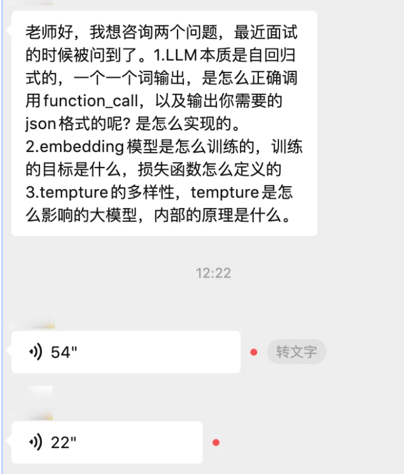

# 10. Function Call 是怎么输出 JSON 的？Embedding 怎么训练的？Temperature 到底改了什么？

今天又复盘学员的问题啦！



这三个问题看似基础，但能答到位的人不多。它们分别考察的是： 结构化生成的工程实现 、 表示学习的训练范式 、 采样策略的数学原理 。面试官问的不是"是什么"，而是"怎么做到的"。

### 问题一：LLM 是自回归的，一个一个词输出，是怎么正确调用 Function Call、输出你需要的 JSON 格式的？

这是一个非常好的问题，它的本质在于： 自回归模型本质上就是在做 next token prediction，它怎么能保证输出的是一个合法的 JSON 结构，而不是随便瞎生成一堆文本？

答案分两个层次：模型层面和工程层面。

#### 1.1 模型层面：通过训练让模型"学会"输出结构化格式

首先要理解，Function Call 的能力不是模型天生就有的，而是通过 SFT（监督微调） 专门训练出来的。

训练时，会构造大量这样的样本：

```
Plain Text
```

模型在大量这类样本上训练后，学会了几件事：

- 意图识别 ：判断当前 query 是否需要调用工具，还是直接回答。

- 格式对齐 ：学会在需要调用工具时，输出特定的结构标记（如 <tool\_call> 和 </tool\_call> ）以及合法的 JSON 内容。

- 参数提取 ：从用户的自然语言中抽取出符合工具 schema 的参数。

但这里有一个关键点： 即使经过 SFT，模型也不能 100% 保证输出合法 JSON。 它仍然是在做概率预测，有可能生成缺少引号、多一个逗号、类型不对等非法 JSON。所以必须有工程层面的兜底。

#### 1.2 工程层面：Constrained Decoding（约束解码）

这是保证 JSON 输出正确性的核心技术，也是面试中最加分的回答。

原理：在每一步 token 生成时，根据当前已生成的内容，动态限制下一个 token 的候选范围。

举个直觉的例子：

- 模型刚输出 {"name": " ，此时下一个 token 只能是工具名称中的合法字符，不能是 } 或数字。

- 模型输出了 {"name": "get\_weather", "arguments": { ，此时下一个 token 只能是参数名的开头引号 " 或者闭合 } 。

具体实现方式：

方法一：基于有限状态机（FSM）/ 正则表达式的约束

这是 Outlines（Dottxt）、vLLM 等框架采用的方案。核心思路是：

1. 把目标 JSON Schema 转换成一个正则表达式或有限状态自动机（FSA）。

2. 在每一步解码时，根据当前 FSA 的状态，计算出哪些 token 是合法的下一步。

3. 将不合法 token 的 logit 设为负无穷（-inf），使其概率为零。

4. 在合法 token 的子集上正常做 softmax 采样。

这个方法的优势是： 生成的结果从数学上保证符合 schema ，不存在"生成完了再校验发现不对"的问题。

方法二：基于 CFG（上下文无关文法）的约束

JSON 本身可以用上下文无关文法精确描述。一些框架（如 Guidance、llama.cpp 的 GBNF）直接用 CFG 规则来约束生成过程。原理类似 FSM，但表达能力更强，能处理嵌套结构。

方法三：特殊 token + 后处理

这是最轻量的方案。模型训练时引入特殊 token（如 <tool\_call> 、 </tool\_call> ），系统检测到起始标记后开始捕获输出，检测到结束标记后尝试解析 JSON。如果解析失败，可以重试或让模型修正。OpenAI 早期的 function calling 实现更接近这种方案。

#### 1.3 OpenAI 的 Structured Outputs 做了什么？

2024 年 OpenAI 推出的 Structured Outputs 功能，底层就是 Constrained Decoding。他们在 API 层面接收用户传入的 JSON Schema，在推理时将其编译为约束规则，动态 mask 非法 token。官方声称在严格模式下 JSON Schema 匹配率为 100%。

#### 1.4 面试怎么答（总结版）

LLM 输出 function call JSON 分两层保障。第一层是模型能力：通过 SFT 让模型学会在需要调用工具时输出特定格式的结构化内容，训练样本中包含特殊标记和标准 JSON 格式。第二层是工程约束：由于自回归模型的概率性质无法 100% 保证格式正确，所以在解码阶段用 Constrained Decoding 技术——将目标 JSON Schema 编译为 FSM 或 CFG 规则，每一步解码时动态 mask 掉不合法的 token，只在合法 token 上采样，从而从根本上保证输出是 schema-compliant 的 JSON。这也是 OpenAI Structured Outputs、Outlines 等框架的核心原理。

### 问题二：Embedding 模型是怎么训练的？训练目标是什么？损失函数怎么定义的？

这个问题其实是在问： 我们是怎么让一个模型把文本映射到一个"语义空间"里，使得相似的文本靠近、不相似的文本远离的？

#### 2.1 训练目标：学习语义相似度的度量

Embedding 模型的目标是学习一个映射函数 f，使得：

- 语义相近的文本 (A, B)：cosine\_sim(f(A), f(B)) → 高

- 语义无关的文本 (A, C)：cosine\_sim(f(A), f(C)) → 低

注意这跟 LLM 的预训练目标完全不同——LLM 学的是"预测下一个词"，Embedding 模型学的是"文本之间的关系"。

#### 2.2 主流训练范式

Embedding 模型的训练通常分多个阶段，从粗到细逐步提升质量。

阶段一：基于预训练模型的初始化

通常以 BERT 类编码器模型（如 BERT、RoBERTa）或解码器模型（如 LLaMA、Mistral）作为基座。对于编码器模型，取 [CLS] token 或做 mean pooling 得到句子向量；对于解码器模型，通常取最后一个 token 的隐藏状态或加一个 pooling 层。

阶段二：对比学习预训练（大规模弱监督数据）

在海量的弱监督文本对（如标题-正文、query-文档、问题-回答）上做对比学习，让模型初步具备区分相关与不相关的能力。这一步数据量大、监督信号弱，目的是"打地基"。

阶段三：有监督微调（高质量标注数据）

在人工标注的高质量相似度数据上做精细训练，进一步提升在目标任务上的表现。

#### 2.3 核心损失函数

（1）对比损失 / InfoNCE Loss

这是目前最主流的训练方式，也是面试必答的。

基本思路：对于一个 anchor（锚点文本），有一个正样本（语义相关的文本）和若干负样本（不相关的文本）。目标是让 anchor 与正样本的相似度高于与所有负样本的相似度。

公式（以 InfoNCE 为例）：

```
Plain Text
```

其中 a 是 anchor，p 是正样本，nᵢ 是负样本，τ 是温度系数，sim 通常是 cosine similarity。

直觉理解 ：这个 loss 的形式和分类问题的 cross-entropy 一模一样——把"从 N 个候选中选出正样本"当作一个 N 分类问题。温度 τ 控制分布的锐度：τ 越小，模型越被迫区分细微差异。

In-batch Negatives ：实际训练中，一个 batch 内的其他样本的正样本互相当作负样本，这样不需要额外采样负样本，训练效率极高。比如一个 batch 有 256 对，每个样本就有 255 个负样本。

（2）Triplet Loss（三元组损失）

早期方法（如 Sentence-BERT 最初版本）使用较多。

```
Plain Text
```

要求正样本的相似度比负样本至少高出 margin。缺点是每次只利用一个负样本，训练效率低，已被 InfoNCE 大幅取代。

（3）Knowledge Distillation Loss（知识蒸馏损失）

用一个强大的 teacher 模型（如 cross-encoder 或 GPT-4）生成 soft label（连续的相似度分数），student 模型（即待训练的 embedding 模型）学习拟合这个分数。

```
Plain Text
L = MSE(sim(f(a), f(b)), teacher_score(a, b))
```

或用 KL 散度来匹配分布。这种方法可以把 cross-encoder 的精度蒸馏到 bi-encoder 中，是提升 embedding 质量的重要手段。

#### 2.4 负样本的构造：训练效果的关键

负样本的质量直接决定 embedding 模型的质量。

- 随机负样本 ：从整个语料库中随机采样。简单但太容易区分，模型学不到太多有用信息。

- In-batch 负样本 ：同一 batch 内其他样本的正样本互作负样本。效率高，适合大 batch size。

- Hard Negatives（难负样本） ：用 BM25 或已有 embedding 模型检索出与 anchor 相似但实际不相关的样本。这类样本能迫使模型学会更精细的语义区分，是训练高质量 embedding 的关键。例如，对于 query "苹果手机价格"，一个 hard negative 可能是"苹果水果价格"。

#### 2.5 现代 Embedding 模型的训练流程（以 BGE / GTE / E5 为代表）

一个完整的训练 pipeline 通常是：

1. 预训练阶段 ：在大规模无标注或弱标注文本对上用 InfoNCE 做对比学习（如 RetroMAE、SimCSE 类似思路）。

2. 精调阶段 ：在高质量标注数据（如 MS MARCO、NLI、STS）上做有监督对比学习，加入 hard negatives。

3. （可选）指令微调 ：近年如 E5-mistral、GTE-Qwen2 等，在第二步之后加入 instruction-following 的训练，使模型能根据不同指令（"检索相关段落" vs "找相似问题"）调整向量表示。

#### 2.6 面试怎么答（总结版）

Embedding 模型的训练目标是学习一个将文本映射到向量空间的函数，使语义相似的文本距离近、不相似的文本距离远。核心训练方式是对比学习，最主流的损失函数是 InfoNCE Loss——将"从 batch 中找到正样本"建模为 N 分类问题，利用 in-batch negatives 提高训练效率。训练效果的关键在于 hard negative mining，即构造那些表面相似但语义不同的样本来迫使模型学会精细区分。现代方案通常分多阶段训练：先在大规模弱监督数据上预训练，再在高质量标注数据上精调，部分前沿模型还会加一步指令微调来支持多任务检索。

### 问题三：Temperature 是怎么影响大模型的？内部原理是什么？

这个问题看起来简单，但要讲清楚"内部原理"，需要从 LLM 的采样过程说起。

#### 3.1 先理解 LLM 的输出过程

LLM 在每一步生成 token 时，经历以下流程：

1. 输入经过模型前向传播，最后一层输出一个 logits 向量 ，维度等于词表大小（比如 32000 维）。

2. logits 经过 softmax 转换为概率分布。

3. 根据概率分布 采样 出下一个 token。

Temperature 就是作用在第 2 步——softmax 之前，对 logits 做一个缩放。

#### 3.2 数学原理

标准 softmax：

```
Plain Text
```

加入 temperature T 后：

```
Plain Text
```

就这么简单—— 在 softmax 之前，把每个 logit 除以 T。

但这个简单的操作效果非常显著：

当 T > 1（高温） ：logits 被压缩，差异变小 → softmax 后概率分布更 平坦 → 低概率 token 的概率被提升 → 采样结果更多样、更随机。

当 T < 1（低温） ：logits 被放大，差异变大 → softmax 后概率分布更 尖锐 → 高概率 token 更突出、低概率 token 几乎为零 → 采样结果更确定、更集中。

当 T → 0 ：等价于 greedy decoding ——每次都选概率最大的那个 token，完全没有随机性。

当 T → ∞ ：所有 token 的概率趋于均匀分布，输出完全随机。

#### 3.3 用具体数字感受一下

假设词表中某一步有 3 个候选 token，原始 logits 为 [3.0, 1.0, 0.5] ：

|   Temperature   |   logits / T   |   softmax 概率   |   行为   |
| --- | --- | --- | --- |
|   T = 0.1   |   [30, 10, 5]   |   [1.00, 0.00, 0.00]   |   几乎确定选 token 1   |
|   T = 0.5   |   [6, 2, 1]   |   [0.94, 0.04, 0.02]   |   大概率选 token 1   |
|   T = 1.0   |   [3, 1, 0.5]   |   [0.80, 0.11, 0.07]   |   token 1 为主，偶尔其他   |
|   T = 2.0   |   [1.5, 0.5, 0.25]   |   [0.54, 0.20, 0.16]   |   三个都有不小概率   |

可以看到，T 从 0.1 变到 2.0，概率分布从"一家独大"变成了"三分天下"。

#### 3.4 Temperature 和其他采样参数的关系

面试中经常会追问 Temperature 和 Top-K、Top-P 的区别和配合关系。

Top-K Sampling ：只保留概率最大的 K 个 token，其余直接置零后重新归一化。问题是 K 是固定的，不够灵活——有时候概率分布很集中只需要 2 个候选，有时候很分散需要 50 个。

Top-P（Nucleus）Sampling ：动态选择候选集——从概率最大的 token 开始累加，直到累计概率达到 P（如 0.95），只在这个动态子集上采样。相比 Top-K 更自适应。

三者的配合（实际使用中的典型流程） ：

```
Plain Text
原始 logits → Temperature 缩放 → Top-K 截断 → Top-P 截断 → 归一化 → 采样
```

Temperature 调节的是分布形状，Top-K / Top-P 调节的是候选集大小。它们作用的层次不同，可以叠加使用。

#### 3.5 实际应用建议

|   场景   |   推荐 Temperature   |   原因   |      |
| --- | --- | --- | --- |
|   代码生成   |   0 ~ 0.2   |   需要确定性和正确性   |      |
|   事实问答 / 结构化输出   |   0 ~ 0.3   |   减少幻觉   |      |
|   通用对话   |   0.5 ~ 0.8   |   平衡流畅和多样性   |      |
|   创意写作 / 头脑风暴   |   0.8 ~ 1.2   |   需要发散思维   |      |

#### 3.6 一个容易踩的坑

很多人以为 Temperature 越高创造力越强。但实际上 T 过高（比如 > 1.5）时，模型输出会变成"胡言乱语"而不是"有创意"。因为概率分布太平坦，模型会频繁选到低质量的 token，导致语义崩塌。真正的"创造力"不是靠随机性，而是靠模型本身的知识质量。

#### 3.7 面试怎么答（总结版）

Temperature 作用在 softmax 之前，将 logits 除以 T 再做 softmax。T 小于 1 时放大 logits 差异，概率分布变得尖锐，输出更确定；T 大于 1 时压缩差异，分布变平坦，输出更随机多样。T 趋近 0 等价于 greedy decoding，T 趋近无穷等价于均匀采样。实际使用中，Temperature 通常和 Top-K、Top-P 配合——Temperature 调分布形状，Top-K/Top-P 调候选集大小。对于 function calling 和结构化输出，通常用极低温度保证格式正确；对于创意任务，适当提高温度增加多样性，但不宜过高以免语义崩塌。

### 延伸考点：面试官可能追问的方向

#### 关于 Function Call

- 如果 Constrained Decoding 会影响生成速度，有没有什么优化方案？ （预编译 FSM、token 级别的缓存、基于 trie 树加速合法 token 查找）

- 模型怎么判断"需不需要调工具"？ （SFT 中训练了 no-tool-call 的负样本 + 可以用特殊 token 作为"不调用"的信号）

- 多轮 Function Call 怎么做？ （维护工具调用结果的上下文链，训练数据中构造多轮调用样本）

#### 关于 Embedding

- Bi-Encoder vs Cross-Encoder 的区别？ （Bi-Encoder 各自编码可离线索引、速度快但精度低；Cross-Encoder 拼接后联合编码、精度高但无法预计算，通常用作 Reranker）

- 怎么评估 Embedding 质量？ （MTEB 榜单、Recall@K、nDCG）

- 如何处理跨语言/长文本 Embedding？ （多语言对比学习、分块+汇聚策略）

#### 关于 Temperature

- Temperature 和 Repetition Penalty 的关系？ （Temperature 调多样性，Repetition Penalty 对已出现 token 做 logit 惩罚防重复，作用层次不同）

- 为什么有些 API 的 Temperature 范围是 0-2？ （这只是 API 层的约束，理论上可以更大，但超过 2 基本没有实用价值）
