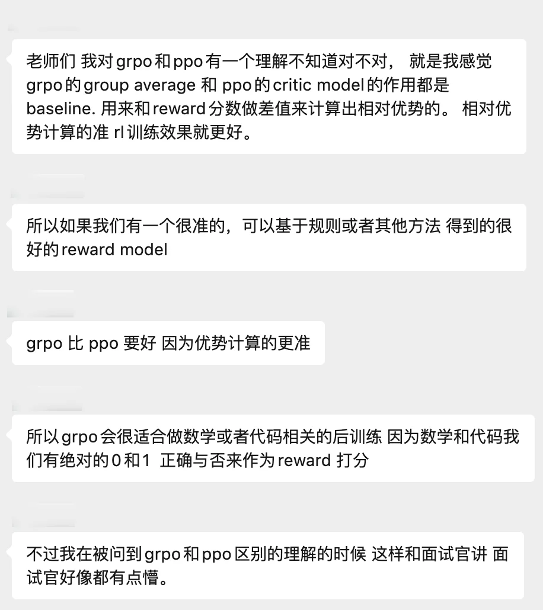

# 11. GRPO 与 PPO 的本质区别

最近又有同学复盘自己的面试问题了。



从一个看似简单的面试问题出发，彻底搞清楚 GRPO 的 Group Average 和 PPO 的 Critic Model 到底是什么关系，以及为什么 GRPO 更适合数学和代码任务的后训练。

### 一、问题起源

面试原话： 「我对 GRPO 和 PPO 有一个理解：GRPO 的 Group Average 和 PPO 的 Critic Model 的作用都是 Baseline，用来和 Reward 分数做差值来计算出相对优势。GRPO 比 PPO 要好，因为优势计算的更准。所以 GRPO 会很适合做数学或者代码相关的后训练，因为数学和代码我们有绝对的 0 和 1 正确与否来作为 Reward 打分。」

——据说面试官听完后"好像都有点懵"

说实话，这位同学的理解其实已经触及了正确方向的边缘，但有几个关键点需要厘清和纠正。让我们逐层拆解。

### 二、PPO 的工作机制

PPO（Proximal Policy Optimization）是 LLM 后训练中最经典的强化学习算法，由 OpenAI 在 InstructGPT 中率先引入。要理解 GRPO 为什么要"革 PPO 的命"，得先搞清楚 PPO 的完整架构。

#### PPO 需要哪些组件？

PPO 在 LLM 训练中需要同时加载 四个大模型 ：

1. Policy Model（策略模型） ：就是我们正在训练的 LLM 本身，输出 token 的概率分布。

2. Reference Model（参考模型） ：冻结的预训练 LLM 副本，用来计算 KL 散度，防止策略跑太远。

3. Reward Model（奖励模型） ：一个独立训练的模型，接收完整回答并输出标量奖励分数。

4. Critic Model / Value Function（价值函数） ：一个可学习的网络，给定当前部分回答，预测未来期望的累计奖励。这就是面试中提到的 Baseline 。

#### Critic 到底在做什么？

PPO 的核心在于计算 优势函数（Advantage） 。直觉很简单：我们不关心一个动作的绝对好坏，而是关心它比"平均水平"好多少。Critic 的作用就是估计这个"平均水平"——即在当前状态下，按照当前策略继续走下去，平均能拿到多少奖励。

```
Plain Text
PPO 的优势计算：
```

关键问题来了： Critic 是一个需要学习的模型 。它本身可能不准，尤其是在 LLM 场景中，Critic 需要从序列级别的奖励（整个回答好不好）去估计每个 token 级别的价值——这非常困难。一个不准的 Critic 会导致优势估计有偏差，进而导致策略更新方向错误。

### 三、GRPO 的核心创新

GRPO（Group Relative Policy Optimization）由 DeepSeek 团队提出。它的核心洞察可以用一句话概括： 既然 Critic 那么难训练准，干脆不要了。

#### 用 Group Average 替代 Critic

GRPO 的做法非常直接：对同一个 Prompt，让模型生成 G 个不同的回答，计算每个回答的奖励，然后用这组奖励的均值和标准差来估计优势。

```
Plain Text
GRPO 的优势计算：
Aᵢ = (Rᵢ - mean(R₁, R₂, ..., R_G)) / std(R₁, R₂, ..., R_G)

其中：
  Rᵢ   = 第 i 个回答获得的奖励
  mean  = 组内所有回答的平均奖励（替代 Critic）
  std   = 标准差，用于归一化
  每个 token 共享同一个优势值（不做 token 级别区分）
```

关键区别：

PPO 的 Baseline ：是一个可学习的 Critic 网络，需要训练，可能不准，尝试在每个 token 位置估计不同的价值。

GRPO 的 Baseline ：是同一 Prompt 下多个采样回答的奖励均值，不需要额外训练，是直接从数据中算出来的统计量。整个回答共享同一个优势值。

### 四、面试回答的逐条分析

#### 论点一："两者的作用都是 Baseline"

判定：大方向正确，但过于简化。

说它们都是 Baseline 没错——两者确实都是用来做"减法"以得到相对优势的。但 Baseline 的 来源和性质 截然不同：

- PPO 的 Critic 是一个 参数化的神经网络 ，它尝试学习状态价值函数 V(s)，在每个 token 位置给出不同的价值估计。这个学习过程本身就会引入偏差和方差。

- GRPO 的 Group Average 是一个 纯粹的统计量 ——同一 Prompt 下采样多个回答，取奖励的算术平均。不需要学习，不会引入模型偏差。

#### 论点二："GRPO 比 PPO 好，因为优势计算的更准"

判定：不够准确，需要更细致的表述。

"更准"这个说法需要打引号。更准确的表述是：

在 LLM 场景中，我们通常只有\*\*结果级别（outcome-level）\*\*的奖励——即整个回答好不好，而没有每个 token 的奖励信号。PPO 的 Critic 试图从这种粗粒度的奖励中推断每个 token 的价值，这几乎是不可能做好的。

GRPO 的设计哲学更务实：既然我们只有结果级别的奖励，那就在结果级别做对比。一个回答的所有 token 共享同一个优势值，不去做 token 级的信用分配（credit assignment）。这种做法不是"更准"，而是 更匹配 LLM 训练的奖励结构 。

#### 论点三："适合数学/代码，因为有 0 和 1 的 Reward"

判定：正确，但归因不够精确。

这个观察是对的，但逻辑链应该更清晰：

数学和代码任务之所以适合 GRPO，核心原因不仅是 Reward 是二值的（0/1），更关键的是这些 Reward 是 可验证的（Verifiable） ——我们可以通过运行代码或检查数学答案来自动判对错，不需要训练一个 Reward Model。

这种范式叫做 RLVR（Reinforcement Learning with Verifiable Rewards） 。在 RLVR 中，GRPO 可以直接用验证器的结果作为奖励，省去了 Reward Model 和 Critic Model，极大简化了训练管线。

### 五、PPO vs GRPO 全面对比

|   维度   |   PPO   |   GRPO   |
| --- | --- | --- |
|   Baseline 来源   |   可学习的 Critic 网络（Value Function），在每个 token 位置给出价值估计   |   同一 Prompt 的多个采样回答的奖励均值，纯统计量   |
|   优势粒度   |   尝试 token 级别的优势估计（通过 GAE 等方法）   |   整个回答共享同一个优势值（sequence-level）   |
|   需要的模型   |   Policy + Reference + Reward Model + Critic（4 个大模型）   |   Policy + Reference（2 个大模型，Reward 可以是规则验证器）   |
|   显存开销   |      |      |

### 六、为什么 LLM 不需要 Critic？

理解 GRPO 取消 Critic 的合理性，需要理解 LLM 训练和传统 RL 的根本差异。

#### 原因一：LLM 不是从零学起

传统 RL（比如训练机器人）中，策略是随机初始化的，方差极大，Critic 的方差缩减作用至关重要。但 LLM 已经经过了大规模预训练，策略的初始点已经相当好了。RL 只是在好的基础上做微调，策略更新的方差本来就不高，Critic 的边际收益有限。

#### 原因二：奖励结构是 outcome-level 的

LLM 的奖励通常是给整个回答打分，而不是给每个 token 打分。PPO 的 Critic 试图把这个序列级奖励分摊到每个 token 上，本质上是在做一个极其困难的信用分配问题。与其做一个不准的 token 级估计，不如老实地在序列级做比较——这就是 GRPO 的思路。

#### 原因三：算力是硬约束

PPO 需要同时在 GPU 上放四个大模型。对于一个 70B 参数的 LLM，光是 Critic 就可能吃掉上百 GB 的显存。GRPO 省掉 Critic，直接把这部分算力释放出来，可以用更多的采样数 G 来得到更好的优势估计。

### 七、面试中应该怎么答

一个更完整的回答框架：

第一层：共性。 PPO 和 GRPO 都是策略梯度算法，都使用 Clipped Objective 来限制策略更新步长，都需要某种形式的 Baseline 来计算优势函数。

第二层：核心差异。 PPO 用一个可学习的 Critic 网络作为 Baseline，尝试做 token 级别的优势估计。GRPO 去掉了 Critic，改为对同一 Prompt 采样多个回答，用组内奖励的均值和标准差来归一化优势，在整个回答级别做对比。

第三层：为什么这样更好。 在 LLM 场景中，奖励信号通常是 outcome-level 的。PPO 的 Critic 试图从粗粒度的奖励信号中推断细粒度的 token 价值，这个任务本身就很难做好。GRPO 的设计更匹配这种奖励结构——不做 token 级信用分配，转而在序列级做相对比较。同时省掉了约 50% 的显存开销。

第四层：适用场景。 GRPO 特别适合 RLVR（如数学、代码），因为这类任务有可验证的、确定性的奖励信号，不需要训练 Reward Model，进一步简化了训练管线。PPO 在需要 nuanced 的 Reward Model 的场景（如开放域对话的 RLHF）中仍然有其价值。

### 八、总结

回到最初的面试问题。那位同学的理解有三个值得肯定的地方：正确识别了两者都在做 Baseline、正确指出了 GRPO 在优势计算上的改进方向、正确关联了 GRPO 与数学/代码任务的匹配性。

需要补强的地方在于：区分 Baseline 的来源性质（学习的 vs 统计的）、说清"更准"的真正含义（更匹配奖励结构，而非绝对意义上更准）、以及理解 RLVR 这个更大的框架。

GRPO 的成功本质上传达了一个工程哲学： 当问题结构允许简化时，简单的方法往往比复杂的方法更可靠。 PPO 的 Critic 是为通用 RL 场景设计的"重武器"，但在 LLM 后训练这个特定场景中，它的复杂度反而成了负担。GRPO 认清了这一点，用最朴素的统计方法取而代之——这不是偷懒，而是对问题本质的深刻理解。
