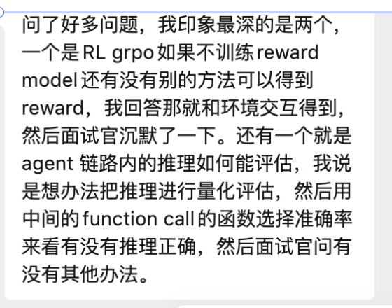

# 12. GRPO 中不训练 Reward Model，还有哪些方式获取 Reward？

### 1 问题背景

面试中被问到：GRPO（Group Relative Policy Optimization）的核心思路是避免训练一个单独的 Reward Model，那么在这种情况下，reward 信号应该从哪里来？

我们的学员当时的回答是"和环境交互获得 reward"，面试官听完后沉默了一下。这个回答并非完全错误，但不够全面，也没有覆盖 GRPO 实际使用中的多种 reward 来源。下面做一个系统性的梳理。

### 2 GRPO 核心机制速览

传统 RLHF 管线中，PPO 需要一个 Critic / Value Model 来估计 baseline。GRPO（DeepSeek 团队提出）做了一个关键简化： 用同一个 prompt 采样一组（group）回答，以组内回答的 reward 均值作为 baseline ，从而移除了 Critic 网络。

但这并不意味着不需要 reward 信号——相反，GRPO 仍然依赖某种方式为每个采样回答打分。问题的关键在于：这个分数从哪里来？

### 3 不训练 Reward Model 时的 Reward 来源

以下是目前实践中常见的几种获取 reward 的方式，按照从"硬"到"软"排列：

#### 3.1 基于规则的验证（Rule-based / Verifiable Reward）

核心思路： 如果任务有明确的正确答案或可验证的约束，就直接用规则打分。

典型场景：

- 数学题：最终答案是否等于标准答案（DeepSeek-R1 的主要做法）

- 代码生成：能否通过单元测试 / 编译是否成功

- 逻辑推理：答案是否满足逻辑约束

- 格式检查：输出是否符合要求的格式（如 JSON schema 校验）

优点： 零成本、无噪声、完全客观。 缺点： 只适用于有明确标准答案的任务。

#### 3.2 LLM-as-a-Judge（用另一个 LLM 打分）

核心思路： 用一个已有的强大 LLM（如 GPT-4、Claude）作为裁判，对生成的回答进行评分或排序。

实现方式：

- Pointwise：直接给每个回答打 1-10 分

- Pairwise：在组内两两比较，转化为胜率 / ELO 分

- 也可以让 Judge 模型按多维度（准确性、流畅度、安全性）分别打分再加权

优点： 适用范围广，开放式任务也能评判。 缺点： 有偏差（position bias、verbosity bias）、推理成本高、存在 reward hacking 风险。

#### 3.3 环境反馈（Environment Feedback）

核心思路： 让模型与外部环境交互，从环境的状态变化或最终结果中获得 reward。这是我面试时给出的回答。

典型场景：

- Agent 场景：工具调用是否成功完成任务（如浏览器操作、API 调用）

- 游戏/机器人：环境给出的奖励信号（如 Atari 得分）

- 对话系统：用户是否完成了目标动作（如下单、解决问题）

优点： 真实、客观、与最终目标对齐。 缺点： 需要可交互的环境、反馈延迟大、reward 稀疏。

#### 3.4 人工标注 / 人类偏好反馈

核心思路： 直接让人类标注者在组内多个回答中选出最好的（或排序），将人类偏好直接作为 reward。

优点： 最接近真实需求。 缺点： 成本极高、速度慢、难以大规模使用。通常只在小规模实验或关键节点使用。

#### 3.5 混合策略（Composite Reward）

核心思路： 实际系统中往往不是单一来源，而是将多种信号加权组合。

例如 DeepSeek-R1 的做法：

- 准确性 reward：规则验证（答案是否正确）

- 格式 reward：是否按要求使用 <think> 标签

- 安全性 reward：是否触发安全过滤器

- 最终 reward = w₁ × 准确性 + w₂ × 格式 + w₃ × 安全性

### 4 对比总结

|   Reward 来源   |   适用场景   |   优点   |   缺点   |
| --- | --- | --- | --- |
|   规则验证   |   数学/代码/逻辑   |   零成本、无噪声   |   需明确标准答案   |
|   LLM-as-Judge   |   开放式文本生成   |   适用范围广   |   有偏差、成本高   |
|   环境反馈   |   Agent / 机器人   |   真实客观   |   需要环境、稀疏   |
|   人类标注   |   通用、关键节点   |   最接近真实需求   |   成本极高、慢   |

### 5 复盘与反思

回顾面试中的回答，"和环境交互获得 reward"是正确的方向之一，但存在两个问题：

1. 不够全面： 面试官可能期望听到多种方式的对比，特别是规则验证（DeepSeek-R1 的核心做法）和 LLM-as-Judge 这两个在 LLM 对齐领域更主流的方案。

2. 缺乏 GRPO 的具体关联： 环境反馈更多是通用 RL 的概念，没有落地到 GRPO 在 LLM 训练中的实际用法（如 DeepSeek-R1 用规则验证数学题正确性）。

更理想的回答框架：

"不训练 Reward Model 的话，reward 信号主要有几种来源：第一是规则验证，比如数学题可以直接比对答案、代码可以跑测试用例，这也是 DeepSeek-R1 的主要做法；第二是用另一个 LLM 作为 Judge 打分；第三是环境反馈，适用于 Agent 类场景；实际系统中通常是多种方式的加权组合。"

### 6 延伸思考

如果面试官继续追问，可能会涉及的进阶话题：

- GRPO vs DPO： GRPO 使用 group-level baseline，DPO 则完全不需要显式 reward，直接从偏好对中学习，两者的适用场景有何不同？

- Reward Hacking： 不管 reward 来自哪里，模型都可能学到"钻空子"的策略。如何检测和缓解？

- Process Reward vs Outcome Reward： 除了只看最终结果，是否可以对推理过程的中间步骤打分？（PRM vs ORM）

- Self-Play / 自我对弈： 能否让模型自己生成 reward 信号？这和 LLM-as-Judge 有什么区别？
