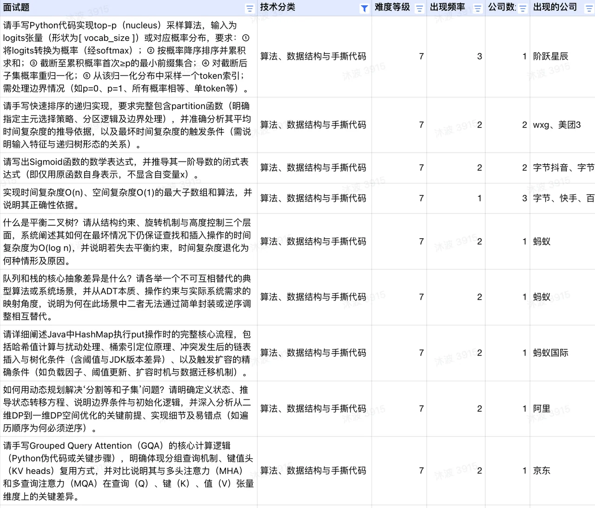

# 06. 手撕代码

从 100+ 道真实面试题中提炼，覆盖 LLM 专项代码、经典算法、数据结构、动态规划、系统设计等



手撕代码在 AI 工程师面试中的定位已经发生了微妙变化。2026 年的面试不再是纯粹的 LeetCode 竞赛，而是分成了两条清晰的考察路线： LLM 专项代码 （手写 Attention、Softmax、采样算法等）和 经典算法基本功 （排序、DP、链表等）。前者检验你是否真正理解模型底层机制，后者检验你的工程编码能力。

统计上看， 手写多头注意力出现了 5+ 次 ， 手写 Softmax 出现了 5+ 次 ， LRU 缓存出现了 4+ 次 ——这三道题构成了 AI 工程师手撕代码的"铁三角"。

### 一、LLM 专项代码：面试的独特区分度

这类题目是 AI 工程师面试区别于普通 SDE 面试的核心。面试官通过这些题直接验证你对模型底层机制的理解——不是"知道原理"，而是"能写出来"。

#### 1.1 手写数值稳定的 Softmax

出现频次： 5+ 次，是 LLM 代码题中的"两数之和"。

考察意图： 检验对数值稳定性的工程直觉。

核心实现：

```python
import numpy as np

def softmax(x):
```

为什么必须减去最大值？

exp(x) 在 x 较大时会溢出为 inf（FP32 下 x > 88 就溢出）。减去最大值后，最大的指数项变为 exp(0) = 1，其余项 ≤ 1，彻底避免了上溢。下溢（exp(极小负数) → 0）不影响结果正确性，因为这些项本来就应该接近零概率。

数学上 softmax(x) = softmax(x - c) 对任意常数 c 成立（分子分母同乘 exp(-c) 抵消），所以减最大值不改变结果。

#### 1.2 手写多头自注意力（Multi-Head Self-Attention）

出现频次： 5+ 次，是 AI 工程师的标志性题目。

考察意图： 验证对 Transformer 核心组件的实现能力，包括维度变换、因果掩码、缩放因子。

核心实现（PyTorch）：

```python

```

面试中的关键追问点：

- 为什么用 transpose(1, 2) 而非 reshape ？ 需要将 head 维度放到 batch 维度之后，使不同头的计算可以并行（矩阵乘法沿 batch 维度并行）。

- contiguous() 为何必要？ transpose 返回的是非连续内存的视图， view 要求连续内存布局。

- 因果掩码为什么用 -inf 而非 0 ？ softmax 前加 -inf 使这些位置的概率归零且保持归一化（详见前篇）。

#### 1.3 Top-p（Nucleus）采样

出现频次： 1-2 次，但区分度极高。

考察意图： 检验对 LLM 解码策略的实现理解。

核心实现：

```python
import torch

def top_p_sample(logits, p=0.9, temperature=1.0):
```

边界情况处理： p=0 时应只返回概率最大的 token（退化为 greedy）；p=1 时不做截断（保留全部 token）；所有概率相等时所有 token 都在候选集中。

#### 1.4 用 torch.logsumexp 实现数值稳定的交叉熵/KL散度

出现频次： 3+ 次，考察对数值稳定性技巧的掌握。

核心思想：

log\_softmax(x) 的数值稳定实现不是先算 softmax 再取 log，而是：

\log \text{softmax}(x\_i) = x\_i - \log \sum\_j e^{x\_j} = x\_i - \text{logsumexp}(x)

torch.logsumexp 内部已做了减最大值处理，因此整个计算链条都是数值稳定的。

```python
def stable_cross_entropy(logits, targets):
    """数值稳定的交叉熵，不使用 F.log_softmax"""
    # logits: (B, C), targets: (B,) 类别索引
    log_softmax = logits - torch.logsumexp(logits, dim=-1, keepdim=True)
    loss = -log_softmax[range(len(targets)), targets]
    return loss.mean()
```

### 二、经典算法高频题

这部分是 AI 工程师面试中的"基本功检测"，题目与传统 SDE 面试高度重叠，但面试官对时间复杂度分析和边界处理的要求更严格。

#### 2.1 快速排序

出现频次： 3+ 次，是排序算法的唯一高频考点。

核心实现与关键要点：

```python
def quicksort(arr, lo, hi):
    if lo >= hi:
        return
    pivot_idx = partition(arr, lo, hi)
    quicksort(arr, lo, pivot_idx - 1)
    quicksort(arr, pivot_idx + 1, hi)

def partition(arr, lo, hi):
    # 三数取中选主元，降低最坏情况概率
```

复杂度分析：

- 平均 O(n log n)：每次 partition 大致将数组对半分，递归深度 O(log n)，每层 O(n) 工作。

- 最坏 O(n²)：当每次 partition 都选到最大/最小值（如已排序数组 + 固定选首元素），退化为 n + (n-1) + ... + 1 = O(n²)。三数取中可有效缓解。

#### 2.2 第 K 大元素（QuickSelect）

出现频次： 4+ 次，是"排序思想的变体应用"考点。

核心思想： 利用快排的 partition，每次只递归目标所在的一半，平均 O(n)。

```python

```

关键点： 随机选主元保证平均 O(n)。最坏仍为 O(n²)，但概率极低。

#### 2.3 最大子数组和（Kadane 算法）

出现频次： 3+ 次，是 DP 入门的经典必考题。

```python
def max_subarray_sum(nums):
    """O(n) 时间，O(1) 空间"""
```

状态转移的含义： curr\_sum 表示"以当前元素结尾的最大子数组和"。每步的决策是：将当前元素追加到前一个子数组，还是从当前元素重新开始。如果前一个子数组和为负数，追加只会让结果更差，因此重新开始。

#### 2.4 链表反转

出现频次： 3+ 次（含"K 个一组翻转"等变体）。

```python

```

K 个一组翻转的关键： 先检查剩余节点是否 ≥ k，不足则保持原序；翻转 k 个后，递归处理剩余部分，将前一组的尾节点指向下一组翻转后的头节点。

### 三、动态规划高频题

DP 题在 AI 工程师面试中的出现频率略低于传统 SDE，但一旦出现，通常要求完整的状态定义、转移方程和空间优化。

#### 3.1 编辑距离

出现频次： 3+ 次，是 DP 的代表性考题。

```python

```

空间优化： 由于 dp[i][j] 只依赖 dp[i-1][j]、dp[i][j-1]、dp[i-1][j-1]，可用一维数组 + 一个临时变量实现 O(n) 空间。

#### 3.2 分割等和子集

出现频次： 2+ 次，常与"0-1 背包"关联考察。

```python
def can_partition(nums):
    total = sum(nums)
    if total % 2 != 0:
        return False
    target = total // 2

    # 一维 DP：dp[j] = 是否能用若干元素凑出和 j
    dp = [False] * (target + 1)
    dp[0] = True

    for num in nums:
        # 关键：必须逆序遍历，防止同一元素被重复使用
        for j in range(target, num - 1, -1):
```

逆序遍历的原因： 如果正序遍历，更新 dp[j] 时用到的 dp[j-num] 可能已经被本轮更新过（即已经包含了当前 num 的贡献），相当于允许同一元素被选多次——变成了完全背包问题。逆序保证每个元素只被选一次。

#### 3.3 最长递增子序列（LIS）

出现频次： 1-2 次，考察 O(n log n) 优化思路。

O(n²) 标准 DP：

```python
def lis(nums):
    n = len(nums)
    dp = [1] * n  # dp[i] = 以 nums[i] 结尾的 LIS 长度
    for i in range(1, n):
        for j in range(i):
            if nums[j] < nums[i]:
                dp[i] = max(dp[i], dp[j] + 1)
    return max(dp)
```

O(n log n) 优化： 维护一个"尾部数组" tails，tails[i] 存储长度为 i+1 的递增子序列的最小末尾元素。对每个新元素用二分查找找到应插入的位置。

### 四、数据结构高频题

#### 4.1 LRU 缓存

出现频次： 4+ 次，是数据结构题的第一高频。

核心要求： get 和 put 均 O(1)。

```python

```

为什么必须哈希表+双向链表？ 哈希表提供 O(1) 的 key 查找；双向链表提供 O(1) 的任意位置删除和头部插入。单用哈希表无法维护访问顺序；单用链表查找需要 O(n)。

#### 4.2 哈希表核心原理

出现频次： 3+ 次（含 HashMap put 流程）。

必答要点：

O(1) 查找的实现： 哈希函数将 key 映射到固定大小数组的索引，直接定位到目标桶。

冲突处理两大流派：

- 链地址法（HashMap 采用）： 每个桶维护一个链表（或红黑树），冲突的元素追加到链表。JDK 8 中链表长度 > 8 且数组长度 ≥ 64 时转为红黑树。

- 开放寻址法： 冲突时按探测序列（线性、二次、双重哈希）找下一个空桶。优势是缓存友好，劣势是删除复杂且负载因子不能太高。

HashMap 扩容机制： 当元素数 > 容量 × 负载因子（默认 0.75）时，数组扩大为 2 倍，所有元素重新哈希分配桶。JDK 8 的优化是利用扩容后新增的高位 bit 判断元素应留在原桶还是移到"原桶 + 旧容量"位置，无需重新计算哈希。

### 五、双指针与滑动窗口

#### 5.1 三数之和（3Sum）

出现频次： 3+ 次，考察排序 + 双指针 + 去重。

```python
def three_sum(nums):
    nums.sort()
    result = []
    for i in range(len(nums) - 2):
        if i > 0 and nums[i] == nums[i-1]:
            continue  # 跳过重复的第一个数
        lo, hi = i + 1, len(nums) - 1
```

#### 5.2 无重复字符的最长子串

出现频次： 2+ 次，滑动窗口的经典应用。

```python

```

### 六、Python 语言特性

AI 工程师面试中 Python 语言题的比重不高，但一旦出现通常是以下几个考点。

#### 6.1 装饰器的本质

出现频次： 3+ 次。

一句话本质： @decorator 是语法糖，等价于 func = decorator(func) 。装饰器接收一个函数，返回一个新函数（通常是闭包），在不修改原函数代码的前提下扩展其行为。

以 @torch.no\_grad() 为例：它返回一个上下文管理器兼装饰器，在 call 中包裹原函数的执行——进入时禁用梯度计算，退出时恢复。

#### 6.2 进程 vs 线程 vs 协程

出现频次： 2+ 次（含与推理服务结合的场景题）。

|   维度   |   进程   |   线程   |   协程   |
| --- | --- | --- | --- |
|   内存   |   独立地址空间   |   共享地址空间   |   共享（单线程内）   |
|   调度   |   OS 内核调度   |   OS 内核调度   |   用户态协作调度   |
|   切换开销   |   高（页表切换）   |   中（寄存器保存）   |   极低（仅保存栈帧）   |
|   GIL 影响   |   不受限   |   受限（CPU 密集型）   |   不受限（单线程）   |
|   适用场景   |   CPU 密集型并行   |   IO 密集型并发   |   高并发 IO（如 API 调用）   |

#### 6.3 *args 和 **kwargs

出现频次： 2+ 次，常与装饰器或函数式编程结合考察。

\*args 将位置参数打包为元组， \*\*kwargs 将关键字参数打包为字典。在 print(\*args) 中， \* 将元组解包为独立参数传递给 print，因此 print(\*(1,2,3)) 等价于 print(1, 2, 3) ，输出 1 2 3 。

### 七、其他高频题速查

以下题目各出现 1-2 次，但在 AI 工程师面试中有一定概率被考到：

二分查找变体： 旋转排序数组搜索——关键是每次二分后判断哪半边是有序的，在有序半边做标准二分判断。

岛屿数量（DFS/BFS）： 遍历矩阵，遇到 '1' 触发 DFS/BFS 将整个连通域标记为已访问，计数器 +1。O(m×n) 时间。

二叉搜索树第 K 大： 中序遍历的逆序（右-根-左），遍历到第 K 个节点即为答案。O(h+k) 时间，O(h) 空间。

最小覆盖子串： 滑动窗口 + 哈希表计数。右指针扩展直到覆盖所有目标字符，然后左指针收缩到刚好不满足覆盖条件，记录最小窗口。

螺旋矩阵遍历： 维护上下左右四个边界，按层顺时针遍历，每遍历一条边后收缩对应边界。

股票买卖最大利润（单次）： 遍历时维护已见的最低价，每步计算当前价-最低价的利润，取最大值。O(n) 时间。

### 附：2026 年 AI 工程师手撕代码的三个趋势

LLM 专项代码成为标配。 手写 Softmax、多头注意力、Top-p 采样、KL 散度——这些题目在传统 SDE 面试中不会出现，但在 AI 工程师面试中已成为与"反转链表"同等频率的基础题。它们的考察价值在于：能写出来的人，对模型底层机制的理解一定是扎实的。

经典算法题"少而精"。 相比传统 SDE 面试动辄覆盖数十种题型，AI 工程师面试的经典算法考察集中在少数几类——快排、LRU、编辑距离、滑动窗口、基础 DP。面试官更看重代码质量（边界处理、复杂度分析）而非题量覆盖。

数值稳定性成为隐性门槛。 手写 Softmax 不做减最大值处理？用 exp + log 而非 logsumexp ？这些看似微小的差异在 AI 面试中会直接影响评价。面试官期望候选人对浮点数运算的陷阱有工程直觉——这是 AI 工程师区别于纯算法工程师的核心能力之一。

基于 100+ 道真实面试题整理，覆盖 LLM 专项代码（Softmax/Attention/采样/KL散度）、经典算法（排序/选择/贪心）、动态规划、数据结构（LRU/哈希表）、双指针与滑动窗口、Python 语言特性六大核心主题。
