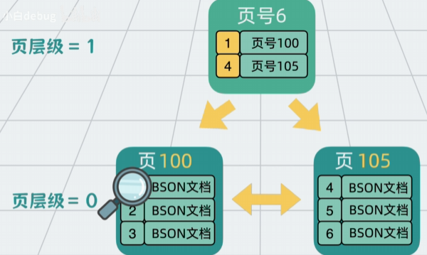
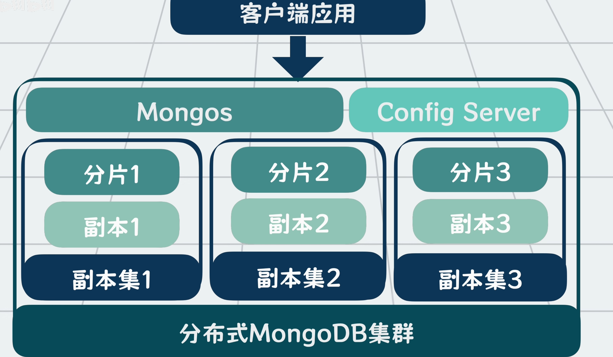
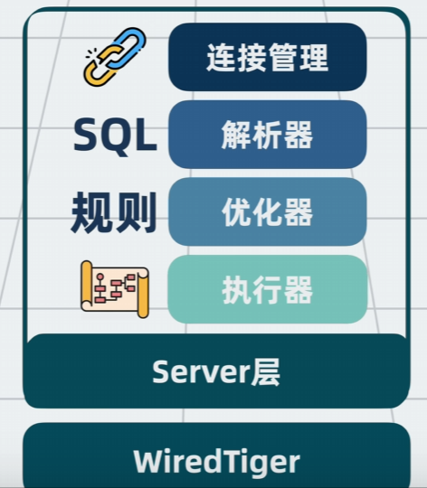
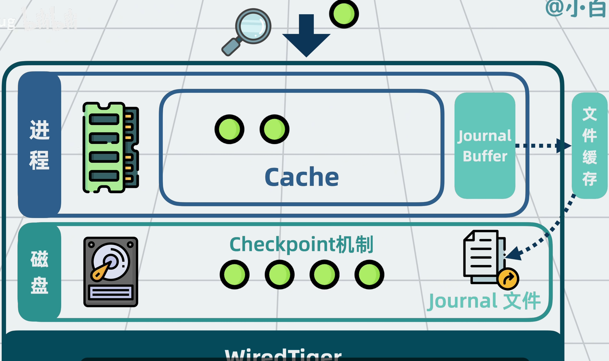

# MongoDB Basic Conceptions
**WiredTiger存储引擎+Server层=MongoDB**
## 高性能
#### 一.文档（Document）与集合（Collection）的定义
**从本质上说，MongoDB就是用于读写集合和文档的服务进程**
1. 文档
- 可以简单理解为：一条数据记录就是一个文档
- 每个文档都有一个主键用来唯一定位文档
- 文档与文档之间的字段不需要完全一致，因此不需要提前定义表结构
2. 集合
- 多个文档组成一个集合

#### 二.BSON（Binary JSON）编码
1. JSON（JavaScript Object Notation）
- 一种轻量级的数据交换格式，以键值对的形式组织数据
- 基本结构：对象、数组
>对象是一个无序的键值对集合，用 {} 表示
>数组是有序的值的集合，用 [] 表示
- 支持的数据类型：
>字符串：字符串必须用双引号括起来，可以包含转义字符
数字：整数或浮点数
布尔值：true 或 false
数组：一个值的有序集合
对象：一个无序的键值对集合
>null：表示空值
2. BSON
- 在JSON基础上做扩展，使其支持**二进制**等数据类型

#### 三.数据页
1. 多个BSON文件作为".wt"文件存储在磁盘中
2. 为了读写高效，将一个.wt文件分为多个数据页，每个页大小为**32KB** 
3. 存取时只需要加载特定的若干数据页，降低IO开销

#### 四.变种B+树索引
1. 为每个数据页加**页号**
2. 将数据页中的BSON文档**按主键大小**进行排序
3. 将**页号以及页内最小主键值**放入一个新的数据页中，并给数据页增加**层级**概念

4. 除了主键之外，也可对其他文档字段建立索引
5. 与MySQL区别
> MySQL更新数据页时为了防止并发写冲突，在从根到叶子节点的搜索过程中会加入短暂内存锁（Latch），并对目标页的行记录加锁
> MongoDB写数据时 [几乎] 不对数据页加锁，而是直接复制一个新的数据页出来写（写时复制Copy On Write）。如此，原本的数据页还能对外提供读操作，之后再在合适是将复制页合并回B+树

#### 五.缓存策略（Cache + LRU淘汰）
1. 先查Cache，未命中再查磁盘
2. 内存中使用LRU对数据页进行调度

#### 六.写前日志Journal
**Write Ahead Logging**
1. 对所有写操作，都先将变更行为记录到**Journal Buffer**缓冲区中，然后在更新到数据页中（内存中）
2. Journal Buffer的数据会定时刷新到磁盘的**Journal文件**中
3. 若服务进程崩溃，可以根据Journal文件找到历史操作记录，重做数据
4. Journal文件顺序写入，因此效率比直接进行数据页写入磁盘（随机写入）高、

#### 七.Check Point机制
1. 定期将内存中**已修改但为写入磁盘的**数据页（脏页）一次性批量写入磁盘
2. 一次批量写入在时间上为一个Check Point，在此检查点之前的Journal日志可以删除
   
#### 八.WiredTiger存储引擎（默认存储引擎）
1. 以上所有构成了WiredTiger存储引擎
2. 对外提供**函数接口**,MongoDB查询语句都会转换为WiredTiger提供的函数接口调用
>update()用于更新数据，对应updateOne语句
search()用于查询数据，对应find语句
>等

#### 九.Server层架构
**本质上是MongoDB查询语句与WiredTiger存储引擎之间的中间层**
1. **连接管理模块**，用于管理客户端应用的网络连接
2. **查询解析器**，用于解析MongoDB的查询语句语法，判断是否有语法错误
3. **查询优化器**，根据一定规则选择使用什么索引，生成**执行计划**
4. **执行器**，根据执行计划调用WiredTiger的接口函数

## 高扩展
1. 面对数据量太大的问题，将数据按照主键值进行范围切分，一个单独的MongoDB（**分片**）存储、处理一个范围的数据
2. 将多个分片部署到一台机器上（Node），通过增加Node来缓解资源压力
3. 客户端应用与分片之间增加**路由服务（Mongos）**，根据查询条件计算出数据应该在哪个分片，然后转发请求到相应分片，收集分片的结果并进行排序，最后返回给客户端
4. 当读写请求量变大，Mongos也可以进行扩展（多个Mongos），**配置服务器Config Server**提供Mongos的配置信息：
> 有哪些分片、每个分片负责的数据范围等
> 
5. 每个分片都连接Config Server并上报自身信息

## 高可用
1. **副本集（Replica Set）**：一个主节点和多个副本节点组成的集群
2. 给每个分片加若干个副本，将分片分为**主节点**和**副本节点**，主节点将数据实时同步给副本节点
3. 副本节点既可对外提供读能力，还可通过**选举机制**在主节点出问题时升级为新的主节点

## 分布式MongoDB集群下，查询更新流程

1. 客户端应用连接到Mongos发起读/写请求
2. Mongos根据请求，基于缓存的分片信息确定数据在那个分片，必要时向Config Server刷新分片信息，将请求转发到对应的分片副本集

3. 在每个分片内部，客户端请求先到达分片的Server层
4. 经过查询分析器解析查询语法，查询优化器选择索引并生成执行计划，执行器调用WiredTiger的函数接口

5. 对于**读操作**，请求发送到WiredTiger存储引擎，WT先检查Cache中是否存在所需数据页：存在则直接返回；否则从磁盘读取数据页加载到Cache中。最后返回数据给Mongos
6. Mongos收集分片的查询结果进行合并、排序等处理，最后返回给客户端
7. 对于**写操作**，变更操作记录到Jounal Buffer（定时将Jounal Buffer数据写入Journal文件），同时复制一份Cache的数据页，写入到复制页中。WT结合CheckPoint机制将修改后的数据页写回磁盘。写操作完成后，分片主节点会将数据实时同步给副本节点，当主节点和**足够数量**的副本节点都写入成功后，分片会返回写入确认给Mongos
8. Mongos收到所有相关分片的写入确认后，最终向客户端返回写操作成功的响应