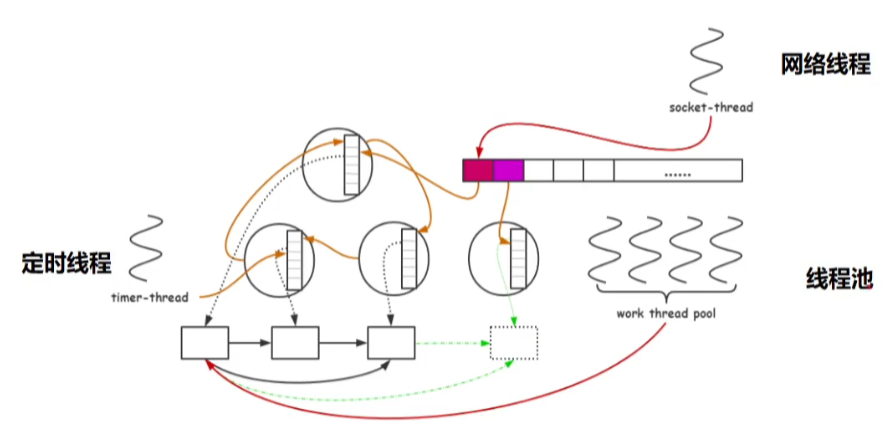
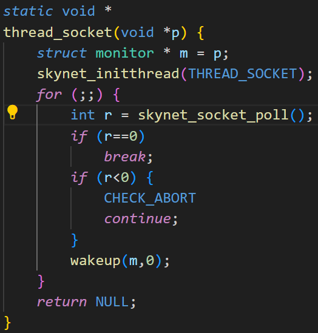
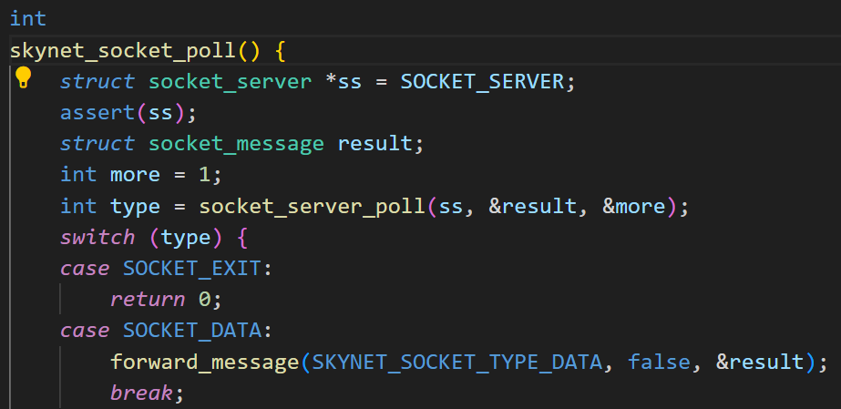
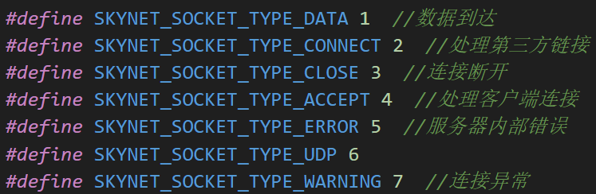
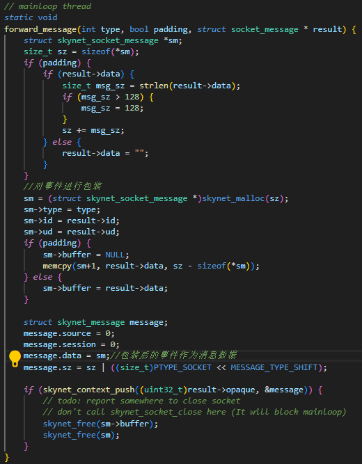

# Skynet
- 轻量级服务器框架：
actor框架+基础组件(网络、接入网络方案、lua虚拟机实现抽象进程、实践轮)
# actor并发模型
## 一.组成
- 通过通信来共享内存，而非使用共享内存进行通信
- 进程隔离性好
### 1.actor抽象进程
-  lua虚拟机（天然隔离，只会解析加载在本虚拟机的代码） + 消息队列（按照消息到达的先后顺序）+ 回调函数
``每个lua虚拟机就是一个独立的actor，运行时从消息队列中取出消息，再将该消息作为参数调用回调函数进行处理 ``
### 2.消息
- 网络消息
**某个fd消息必定会路由到特定的actor中**
``fd，file descriptor文件描述符，通常是一个socket连接的唯一标识符``
``fd消息，从某个特定的socket连接收到的网络数据，或者于该连接相关的事件（如连接关闭、异常）组成的消息``
- actor之间消息
``通过消息进行共享、交换数据``
- 定时消息
``处理某些延时消息``
### 3.协程
**为了阻塞一个执行体但不阻塞线程**
``比线程更轻量级的程序执行单元，它允许在单个线程中实现多任务协作运行。与线程不同，协程不是由操作系统调度，而是由程序自身控制切换时机``
- __用户态调度__
  协程的切换完全在用户态完成，不涉及内核态上下文切换，因此性能开销极低。

- __协作式多任务__
  协程不会被抢占，只有在显式调用 `yield`（让出执行权）时才会切换到其他协程，这使得开发者可以精确控制执行流程。

- __轻量级__
  协程的创建、销毁和切换成本远低于线程，通常可以同时存在成千上万个协程。

- __保持执行上下文__
  协程在挂起时会保存当前的执行状态（局部变量、指令位置等），恢复时可以从中断处继续执行。

## 二.actor编程思路
**从业务角度划分actor进程**

## 三.actor调度

### 分析线程池
- 线程池只作用在全局消息队列
- 全局消息队列组织 **活跃的（有消息的）** actor消息队列
1. 列举生产(消息)者和消费者
``生产者：网络线程、定时线程、线程池``
``消费者：线程池``
2. 线程池  如何唤醒、如何休眠
## 线程池中的线程无需唤醒池中其他线程，只需在消息队列中加消息就行
## 使用原子操作配合条件变量来实现线程的休眠与唤醒
``休眠：任务从有到无，pthread_cond_wait用于让线程在“某个条件未满足”时挂起``
``唤醒：任务从无到有，pthread_cond_signal唤醒一个正在等待该条件变量的线程``

3. 当部分 actor 有大量消息堆积，而其他 actor 比较空闲时，如何避免系统整体“卡在热点 actor”上，保持高吞吐和公平性？
- Skynet 的处理策略：调度次数限额 + 全局队列轮询机制
``  actor 调度次数限制（dispatch limit）``
``  Skynet 在每次调度一个 actor 时，只处理该 actor 消息队列中的前 N 条消息（比如默认 N=1）。`` 
``  如果该 actor 队列中还有剩余消息，就把它再次加入 global_queue，等待下一轮调度。``

# reactor网络模型 
**异步  事件**
## 组成
IO多路复用+非阻塞IO
**从封装层面**
1. IO检测
``事件控制(epoll_ctl)：注册事件、修改事件、注销事件等``
``事件循环(epoll_wait)：用阻塞接口，将网络中触发的事件从内核拷贝至用户态，然后依次处理``
2. IO操作
``1).连接的建立：处理客户端的连接accept；处理第三方连接（服务器作为客户端）connect``
``2).连接的断开：主动断开close；被动断开(半关闭状态)``
``3).数据的到达(界定数据包)：读取固定字节的数据readn；读取分隔符所分隔的数据readline``
``4).数据的发送完毕(数据发送到内核协议栈中的某个fd的写缓冲区)write send``
3. 事件对象的封装

# actor与reactor合作
## 一.事件包装成消息
## 二.事件与actor进行绑定
## 三.协程将异步转化为同步
1. 事件循环处理

2. 将事件转化为消息类型

``网络异常 warning处理``
``1.IO多路复用检测到异常，epollerr消息通报错误``
``2.IO操作检测到异常，如read()结果=-1，用errno错误码通报错误``