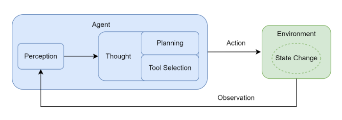

# 02.02 Agent 的端到端任务能力

## 1. 总体性概念

AI Agent 是在环境中围绕目标自主选择行动的系统。经典定义是通过 Sensors 感知 Environment，再通过 Actuators 采取 Action，以优化 Performance。对 LLM Agent 而言，它不仅回答问题，还能协调模型、状态、记忆和真实工具完成复杂任务。

“端到端”不是一步生成所有结果，也不是省略中间模块，而是用户只描述目标，系统负责目标理解、任务拆解、状态维护、工具执行、错误修正、停止判断和最终交付。

## 2. 用 PEAS 描述任务环境

- **Performance（性能度量）**：任务成功率、正确性、约束遵循、延迟、token/费用、安全性；
- **Environment（环境）**：API、数据库、搜索、文件系统、Web、业务系统、会话上下文和任务状态；
- **Actuators（执行器）**：调用 API、写文件、发送请求、输出文本或调用其他模型；
- **Sensors（传感器）**：用户输入、工具结果、系统事件和外部状态变化。

PEAS 让“做一个 Agent”变成可验证的问题：它在什么环境中工作，能看到什么，能改变什么，怎样才算完成得好。

## 3. Agent Loop



1. **Perception（感知）**：接收用户指令、工具结果或环境变化，形成 observation；
2. **State Update（状态更新）**：把新 observation 与目标、计划、历史证据合并；
3. **Planning / Decision（规划与决策）**：基于当前状态决定下一步，可制定或调整计划；
4. **Tool Selection（工具选择）**：选择获准工具并生成参数；
5. **Action（行动）**：应用执行工具，对环境产生影响；
6. **Evaluation / Stop（评估与停止）**：判断证据是否充分、目标是否完成，或是否触发步数、超时和失败边界。

这里的 Thought 指模型参与的决策阶段，不要求向用户暴露或永久保存模型的逐字内部推理。工程上更适合记录计划、动作理由摘要、工具参数、observation 和状态变化，以便审计和调试。

## 4. 最小运行机制

```python
state = {
    "goal": user_goal,
    "plan": [],
    "observations": [],
    "steps": 0,
}

while state["steps"] < MAX_STEPS:
    decision = decide_next_action(state)

    if decision.type == "final":
        return validate_and_deliver(decision.content, state)

    check_permission(decision.tool, decision.args)
    observation = run_tool_with_timeout(decision.tool, decision.args)
    state["observations"].append({
        "action": decision.public_summary,
        "tool": decision.tool,
        "args": decision.args,
        "result": observation,
    })
    state["steps"] += 1

raise StepLimitExceeded(state)
```

模型通常负责语义理解和不确定决策；应用负责权限、参数 schema、真正执行、异常处理和确定性边界。工具结果必须写回 observation，否则模型无法依据环境反馈修正后续动作。

## 5. 端到端能力的必要组件

- **显式 State**：当前目标、计划、进度、证据、错误与用户确认，而不只是聊天文本；
- **Planner / Executor / Evaluator**：可以是独立组件，也可以由一个模型在不同阶段承担；
- **Memory**：区分当前工作上下文与需要检索的长期记忆；
- **停止条件**：任务完成、证据充分、最大步数、超时、预算、重复循环或人工终止；
- **可靠工具层**：schema、鉴权、最小权限、超时、幂等、重试、补偿；
- **可观测性**：状态转移、模型请求、工具参数和结果、成本、延迟、异常；
- **失败恢复**：checkpoint、可重放输入、可恢复节点和人工接管。

## 6. 常见误区

- 把多轮聊天等同于 Agent：没有工具、状态和环境反馈时，仍主要是文本生成；
- 把“自主”理解为无限权限：自主决策必须位于应用授权边界内；
- 只设计成功路径：工具会失败，外部状态会变化，模型也可能循环；
- 让模型自行保证幂等：副作用控制必须由工具或业务系统实现；
- 没有明确完成标准：Agent 可能过早结束，也可能无止境继续搜索。

## 7. 类比理解

普通 LLM 像提供建议的顾问；Agent 像能查看系统、使用工具、记录进度并对结果负责的助理。助理可以规划工作，但门禁、财务权限、操作日志和最终审批仍由组织制度控制。

## 8. 理解推进与关联知识点

理解路径是从“LLM 文本输入输出”推进到“感知—状态—决策—行动—观察—停止”的工程闭环。

- 行动范式：`06_MRKL、ReAct、ToT_与_Plan-and-Execute.md`
- 工具接入：`03_Function_Calling_与_MCP_工具接入.md`
- 状态图：`11_LangGraph_状态更新、invoke_与_stream.md`
- 记忆分类：`12_Agent_Memory_四类：短期、情景、语义、程序性.md`
- 框架选型：`10_Agent_开发框架与选型.md`

## 9. 参考资料

- [Datawhale hello-agents](https://github.com/datawhalechina/hello-agents)
- [AI Agent 综述](https://zhuanlan.zhihu.com/p/1895877953453265781)
