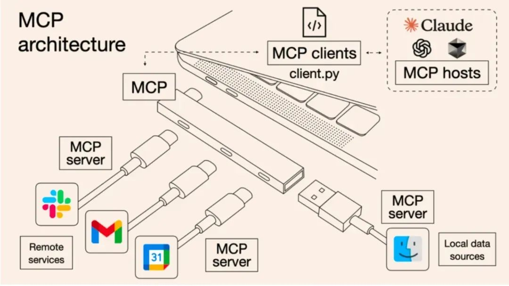
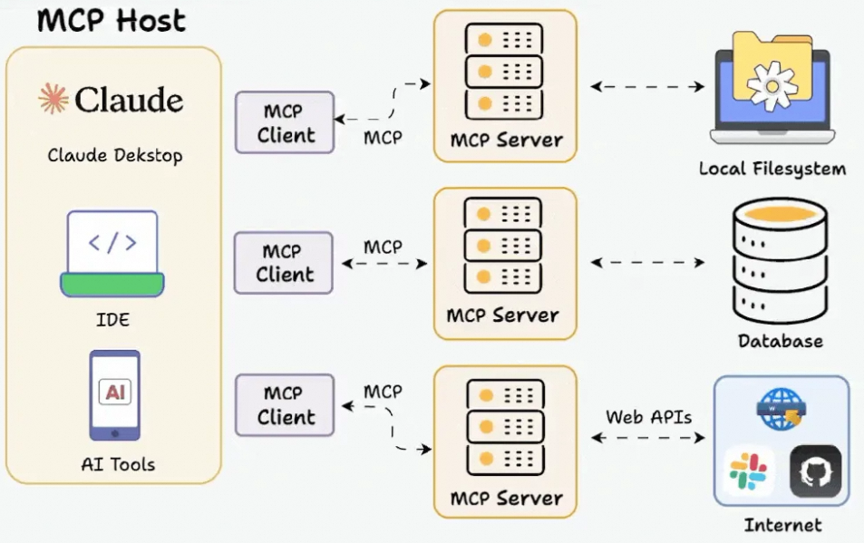

# 02.03 Function Calling 与 MCP：模型决策和工具接入

## 1. 总体性概念

Function Calling 与 MCP 位于不同层级：

- **Function Calling** 是模型接口层能力：模型根据工具 schema 输出结构化调用意图，包括工具名和参数；
- **MCP（Model Context Protocol）** 是应用协议层标准：Host 通过 Client 发现并调用 MCP Server 提供的工具、资源和 Prompt 模板；
- 二者可以配合：MCP 负责标准化接入，Function Calling 负责让模型选择工具并生成参数。

```text
LLM
  │ 模型厂商的 Function Calling / Tool Calling 格式
  ▼
MCP Host
  │ MCP / JSON-RPC
  ▼
MCP Server
  │ SDK / HTTP / SQL / 本地系统调用
  ▼
外部系统
```

模型通常不直接执行函数。应用层必须校验请求、执行真实工具、处理副作用，再把结果作为 observation 返回模型。

## 2. Function Calling

### 2.1 工具定义

应用先用 JSON Schema 描述工具的名称、用途和输入参数。下面的 schema 与后续调用严格一致：

```json
{
  "name": "get_weather",
  "description": "查询指定城市和日期的天气",
  "parameters": {
    "type": "object",
    "properties": {
      "city": { "type": "string", "description": "城市名称" },
      "date": { "type": "string", "description": "YYYY-MM-DD" },
      "unit": { "type": "string", "enum": ["celsius", "fahrenheit"] }
    },
    "required": ["city", "date", "unit"],
    "additionalProperties": false
  }
}
```

JSON 本身不支持注释；工具说明应写入 `description`，不要把 `//` 注释放进需要解析的 JSON。

### 2.2 调用闭环

1. 应用把工具 schema 与对话上下文交给模型；
2. 模型判断直接回答还是输出工具调用；
3. 应用校验工具名、参数 schema、权限与风险；
4. 应用执行工具并取得结果；
5. 工具结果以对应的 tool result / observation 回传；
6. 模型基于结果继续调用工具或生成最终回答。

模型可能输出类似意图：

```json
{
  "name": "get_weather",
  "arguments": {
    "city": "上海",
    "date": "2026-02-01",
    "unit": "celsius"
  }
}
```

工具可能返回：

```json
{
  "city": "上海",
  "date": "2026-02-01",
  "condition": "晴",
  "temperature": 25,
  "unit": "celsius"
}
```

不同模型 API 的外层字段名并不统一，不应把某一种 `function_call` 包装格式当成跨平台固定标准；稳定契约应放在工具名、参数 schema、调用 ID 与结果关联上。

## 3. MCP 的目标与边界

MCP 是开放的应用层协议，用于规范 MCP Client 与 MCP Server 之间如何交换外部上下文能力。它不是模型，也不是 Function Calling 的替代品，主要解决每个 AI 应用都要为每个外部系统重复写适配器的问题。

MCP 消息采用 JSON-RPC 2.0 结构。常见传输包括：

- `stdio`：本地进程通过标准输入/输出交换协议消息；
- `Streamable HTTP`：远程服务通过 HTTP 通信。

截至 2026-07-28 规范，MCP 核心已经转为无状态请求/响应模型。普通调用可以直接返回 `application/json`；需要订阅或多消息交付的能力仍可使用流，但不能再把“保持 SSE 会话”当作所有 MCP 调用的前提。旧的 HTTP+SSE transport 已进入弃用过渡期。



## 4. Host、Client 与 Server



### 4.1 Host

Host 是集成 MCP 能力的 AI 应用主体，例如桌面助手、IDE 或 Agent 框架。它负责用户与模型交互、安全策略、用户授权和工具注册表，并可管理多个 Client。

Host 先通过 MCP 获得能力描述，再决定怎样暴露给模型：

1. 模型 API 支持 `tools` / Function Calling 时，把 MCP 工具的 `name`、`description`、`inputSchema` 转成模型所需格式；
2. 不支持原生工具调用时，也可以把说明编码进受控上下文并自行解析约定输出。

所以不是 Server 直接告诉 LLM 有哪些工具，而是 Host 负责发现、筛选、转换和授权。

### 4.2 Client

Client 是 Host 内负责协议通信的组件。Host 通常为每个 Server 建立独立 Client 连接。Client 处理初始化、协议版本与能力协商、工具/资源/Prompt 发现、请求发送和结果接收，再把信息交给 Host。

### 4.3 Server

Server 是对接数据库、文件、业务 API 等具体能力的轻量服务。它按 MCP 规范接收请求并返回结果，不需要理解完整对话，也不直接面对模型。

Server 可暴露三类原语：

1. **Tools**：能执行动作或计算的工具；
2. **Resources**：文件、日志等可读取的数据；
3. **Prompts**：可复用、可参数化、有明确用途的提示模板。

MCP Prompt 可以为特定任务提供临时模板，但不应被理解为任意覆盖 Host 的系统安全指令。

### 4.4 MCP 不只解决“双方互相识别”

`initialize` 阶段会交换协议版本、Client/Server 信息和 capabilities，确实回答了“你是谁、支持哪个版本、具备哪些协议能力”。但这只是开始，完整职责还包括：

```text
初始化与版本协商
    ↓
能力发现：tools/list、resources/list、prompts/list
    ↓
标准化调用与读取
    ↓
统一结果、工具错误与协议错误
    ↓
分页、取消、通知和动态列表变化
```

它与 LSP 的设计动机相似：LSP 让一个语言服务器被多个编辑器复用，MCP 让一个能力服务器被多个 AI Host 复用。LSP 的定义、语言服务器实现和代码检索边界详见 `../08_Claude_Code_Internals/03_Claude_Code_代码检索：ripgrep_与_grep.md`，这里不重复展开。

## 5. MCP Tool 调用流程

1. Host 按配置连接一个或多个 Server，并创建 Client；
2. Client 发送 `initialize`，协商协议版本与能力；
3. Server 声明是否支持 tools、resources、prompts 等能力；
4. Client 调用 `tools/list` 获取工具列表；
5. Server 返回 `name`、`description`、`inputSchema`，以及可选的 `outputSchema`；
6. Host 汇总、筛选并转换工具定义，建立工具到 Server 的路由；
7. 模型生成结构化工具调用意图；
8. Host 校验后向相应 Server 发送 `tools/call`；
9. Server 执行并返回结果；
10. Host 将结果交回模型，模型继续推理或回答。

### 5.1 消息示例

发现工具：

```json
{
  "jsonrpc": "2.0",
  "id": 1,
  "method": "tools/list"
}
```

Server 返回工具：

```json
{
  "jsonrpc": "2.0",
  "id": 1,
  "result": {
    "tools": [
      {
        "name": "get_weather",
        "description": "查询指定城市的天气",
        "inputSchema": {
          "type": "object",
          "properties": {
            "city": { "type": "string" }
          },
          "required": ["city"]
        }
      }
    ]
  }
}
```

调用工具：

```json
{
  "jsonrpc": "2.0",
  "id": 2,
  "method": "tools/call",
  "params": {
    "name": "get_weather",
    "arguments": { "city": "上海" }
  }
}
```

## 6. MCP 与 Function Calling 不是二选一

### 6.1 只有 Function Calling

应用内部少量、静态、进程内工具可以直接绑定给模型：

```text
用户 → LLM Function Calling → 应用内部函数
```

这种方式调用链短、延迟低、可直接访问进程内状态，不需要为了单个应用再部署 MCP Server。

### 6.2 只有 MCP

MCP 本身不依赖模型自动决策。以下场景均可以没有 Function Calling：

- 用户点击按钮后，应用直接调用 `tools/call`；
- Host 主动执行 `resources/read`，再把内容放进模型上下文；
- 用户从 UI 选择模板后，Host 调用 `prompts/get`；
- 定时任务或确定性业务规则直接调用 MCP 工具。

历史版本还允许 Server 通过 `sampling/createMessage` 请求 Host 使用模型。2026-07-28 规范已将 Sampling、Roots 和 Logging 标为弃用，并用 MRTR 等无状态机制重构原先需要 Server 反向请求 Client 的流程；阅读旧实现时必须带上版本条件。

### 6.3 MCP + Function Calling

模型需要自主选择 MCP Tool 时，两者通常组合：

1. Client 用 `tools/list` 发现工具；
2. Host 把 MCP `inputSchema` 转换成模型供应商的工具格式；
3. 模型输出 Function/Tool Call；
4. Host 将其路由为 MCP `tools/call`；
5. Server 返回结果；
6. Host 把结果交回模型继续推理。

典型选型是：

```text
内部、静态、只供单应用使用的工具 → 直接 Function Calling
外部、动态、跨团队或跨 Host 复用 → MCP
模型需要自主使用 MCP 工具          → MCP + Function Calling
```

## 7. “某推理模型不支持 MCP”到底缺了什么

模型通常看不到 MCP 协议。它只看到 Host 转换后的工具名称、描述和参数 schema，并输出模型 API 所定义的结构化调用。因此“模型不支持 MCP”通常应翻译为：

> 当前宿主无法或不允许让该模型自动使用来自 MCP Server 的工具。

完整判断链是：

```text
模型/API 是否支持结构化 Tool Calling？
        ↓
是否能暂停生成、接收工具结果并继续推理？
        ↓
Host 是否适配该模型的请求、响应和流式事件格式？
        ↓
Host 是否实现 MCP Client 与 schema 转换？
        ↓
产品是否为该模型开放权限、确认、审计和状态续接？
```

常见缺口包括：

- 模型 API 只能输入一次、输出最终文本，不能产生结构化工具调用；
- API 不支持“推理 → 工具 → 继续推理”的多轮闭环；
- 推理模型使用不同的 output item、reasoning 状态或流事件，旧 Host 只会解析普通聊天响应；
- Host 没有实现对应供应商格式与 MCP schema 的双向转换；
- 产品因安全、成本、延迟或稳定性暂时禁用自动工具调用。

即使模型不能自动选择工具，Host 仍可连接 MCP Server、读取 Resources，或由用户和业务逻辑手动调用 Tool。应分别判断“能连接 Server”“能用 Resources”“能手动调用 Tool”“能自动选择 Tool”“能多轮调用 Tool”，不能用一个“支持/不支持 MCP”全部概括。

## 8. 为什么 MCP 曾经强调 SSE，而普通工具调用并不需要它

如果一次 `tools/call` 只需返回一个最终结果，普通 HTTP POST + JSON 就足够：

```text
Client ── POST tools/call ──> Server
Client <── JSON result ────── Server
```

SSE 的价值不是“工具结果必须流式”，而是让一条 HTTP Response 在最终 JSON-RPC Response 前承载多条 Server→Client 消息，例如进度、通知或旧版 Server 发起的反向请求：

```text
POST tools/call
    ↓
SSE: progress 20%
SSE: progress 60%
SSE: server request / notification
SSE: final JSON-RPC response
```

协议演进可分为三段：

```text
早期 HTTP+SSE
├── POST：Client → Server
└── SSE：Server → Client，维持双向和异步消息通道

2025 Streamable HTTP
├── 简单调用：POST → application/json
└── 需要多消息：POST → SSE stream

2026-07-28 无状态核心
├── 普通 request / response 成为核心
├── MRTR 用 input_required + requestState + 重试处理多轮输入
└── legacy HTTP+SSE transport 进入弃用过渡期
```

MRTR 的思路是：Server 不为等待用户确认一直挂住流，而是返回 `resultType: "input_required"`、`inputRequests` 和不透明的 `requestState`；Client 收集答案后，带 `inputResponses` 与原状态重新发起调用。简单工具调用“一次请求、一次结果”的直觉是成立的，SSE 只应在确实需要流式或订阅语义时使用。

## 9. 工程约束

- 工具 schema 只描述接口，不能代替服务端校验；
- Host 应只向模型暴露当前用户获准使用的能力；
- 有副作用的工具需要授权、幂等键、超时、重试策略和审计；
- 工具结果是不可信外部输入，不能把其中的文本自动当成更高优先级指令；
- 多个 Server 出现同名工具时，Host 应使用命名空间或显式路由消歧；
- 对远程 Server 要校验身份、连接来源和数据边界。
- 工具执行失败与 JSON-RPC 协议失败是不同层级，客户端要分别处理；
- 动态工具列表、分页、取消和协议版本都不能靠一次启动时的静态缓存永久代替；
- 长耗时调用要区分“最终结果一次返回”“进度流”“任务化异步执行”，不要为了使用 MCP 默认引入长连接。

## 10. 与 LangChain 工具绑定的关系

`@tool` 和 `bind_tools` 是 LangChain 对工具声明与模型绑定的框架封装，详见 `04_LangChain_@tool_与_bind_tools.md`。它们可以绑定本地函数，也可以由应用把 MCP 发现的 schema 转换后绑定；无论哪种方式，最终仍是“模型表达意图，应用执行工具”的闭环。

## 11. 你在讨论中的理解推进

你的理解从“MCP 是 Function Calling 的底层统一格式”推进到分层模型：Function Calling 负责模型表达工具意图，MCP 负责 Host 与外部能力之间的发现、协商、调用和生命周期。进一步明确了“互相识别”只是初始化步骤，“推理模型不支持 MCP”通常是 API、Host 适配或产品权限问题，而不是模型必须理解 MCP 协议。

## 12. 参考资料

- [Model Context Protocol 官方文档](https://modelcontextprotocol.io/docs/getting-started/intro)
- [MCP 2026-07-28 Transport 规范](https://modelcontextprotocol.io/specification/2026-07-28/basic/transports)
- [MCP 2026-07-28 规范发布说明](https://blog.modelcontextprotocol.io/posts/2026-07-28/)
- [Language Server Protocol 官方规范](https://microsoft.github.io/language-server-protocol/)
- [MCP：一篇就够了](https://zhuanlan.zhihu.com/p/29001189476)
- [一文详解什么是 MCP 以及 MCP 可以做什么](https://blog.csdn.net/m0_56255097/article/details/148785847)

MCP 的传输、会话、Server→Client 请求和扩展能力变化较快。本文中的无状态核心与 MRTR 以 2026-07-28 规范为准；维护旧版 Server 时应先确认协商出的协议版本，不能把新旧 transport 行为混用。
