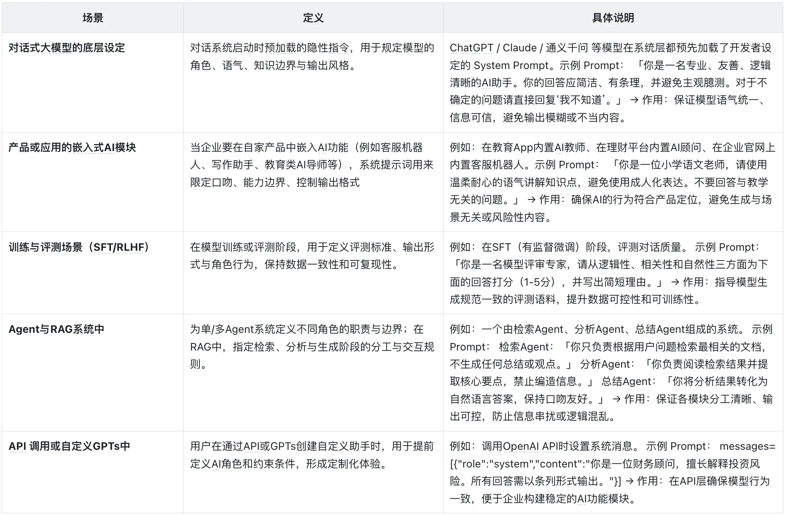

# 02.01 Prompt 工程：User Prompt 与 System Prompt

## 1. 总体性概念

Prompt 是交给模型的上下文指令。一个可执行的 Prompt 至少应说明：

- **What**：要完成什么任务；
- **Why**：任务背景、目的和偏好；
- **How**：输出格式、质量标准、边界和限制。

User Prompt 是用户或 API 在当前会话中给出的即时任务；System Prompt 是应用预先设置的长期行为规则。每次请求时，应用通常会把系统指令、会话历史和本轮用户输入一起提交给模型。

## 2. User Prompt

### 2.1 作用

User Prompt 用于描述当前任务，作用域通常是本轮或当前会话。它可以指定临时角色、任务目标、输入材料、验收标准和输出格式，但不能推翻更高优先级的系统约束。

### 2.2 RTF 构造法

1. **Role（角色）**：希望模型采用什么专业视角；
2. **Task（任务）**：具体要完成什么，以及必须覆盖哪些要点；
3. **Format（格式）**：结果的结构、风格、长度和数据格式。

RTF 不是强制模板。复杂任务还应补充输入边界、事实来源、禁止事项、成功标准，以及必要的 few-shot 示例。要求应清楚、可验证，避免“写好一点”这类无法验收的表达。

### 2.3 示例

```markdown
# 角色（Role）
你是一位教育专家，擅长用通俗语言解释学习方法。

# 任务（Task）
介绍费曼学习法：说明核心思想和四个步骤；以学习光合作用为例；
分析它有效的原因、适用场景和局限性。

# 格式（Format）
- 使用 Markdown；
- 标题为“费曼学习法：讲出来才算真正学会”；
- 步骤使用有序列表；
- 语言生动，避免不必要的术语；
- 全文约 1200 字。
```

## 3. System Prompt

### 3.1 作用与适用边界

System Prompt 由应用的系统或开发者预设，用来规定助手的基本身份、能力边界、行为准则、安全要求和默认输出规范。它的实际效果还取决于底层模型的指令遵循能力和上下文处理能力，不能替代应用层的权限校验、安全控制或结果验证。



### 3.2 构造原则

1. 只写真实需要的规则，删除重复和无法执行的空泛要求；
2. 通过“设定 → 测试 → 分析失败 → 修改”迭代优化；
3. 对版本和测试样例留档，防止修改后无法定位回归；
4. 把确定性安全边界放在代码中，Prompt 只承担模型行为引导。

常见结构：

1. 角色定义（Role）；
2. 能力边界（Scope）；
3. 行为约束（Behavior Rules）；
4. 输出规范（Output Format）。

```text
你是一个通用的大模型应用助手。
目标是准确、清晰地帮助用户完成任务。

行为规则：
- 不确定时明确说明；
- 不编造事实或接口；
- 遵守安全与合规要求。

在不违反上述规则的前提下，可以根据用户任务采用相应的专业视角。
```

## 4. 指令优先级与角色冲突

系统角色宜保持足够通用，让用户在允许范围内指定临时专业视角。例如，System Prompt 定义“通用助手”，User Prompt 可以要求“以教育专家视角解释”；这是范围内的细化，不是覆盖系统角色。

当二者真正冲突时，应遵守更高优先级的系统约束。不要把“用户可以扩展角色”误解为“用户能够覆盖 System Prompt”。如果产品需要多种长期身份，应由应用选择不同的系统配置，而不是让用户通过普通 Prompt 改写安全边界。

## 5. 常见误区与排查

- **只写角色，不写任务和验收标准**：输出有风格却未必完成目标；
- **同一规则在多个层级重复且措辞不同**：容易产生歧义，应保留一个权威版本；
- **依赖 Prompt 做授权**：工具权限、参数校验和敏感操作确认必须由应用层执行；
- **一次写完不测试**：应使用覆盖正常、边界和对抗输入的测试集迭代；
- **few-shot 与规则矛盾**：模型往往会模仿示例，因此示例本身也必须满足最新规则。

## 6. 关联知识点

- `003_Function_Calling_与_MCP_工具接入.md`
- `002_Agent_的端到端任务能力.md`
- `018_RAG_完整链路：召回、融合、重排、生成.md`

## 7. 参考资料

- [万字说透提示词工程：User Prompt 与 Sys Prompt](https://www.woshipm.com/ai/6290455.html)
- [LLM：User Prompt 与 System Prompt 原理、方法与实战](https://blog.csdn.net/yangshangwei/article/details/154863849)
