# 深度学习基础：回归、梯度下降与评估指标

## 1. 基本概念

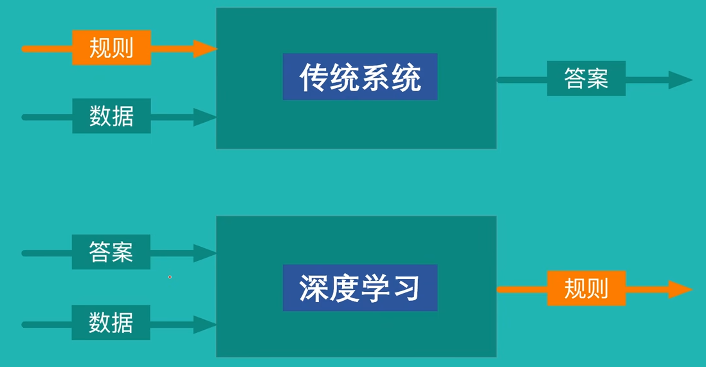

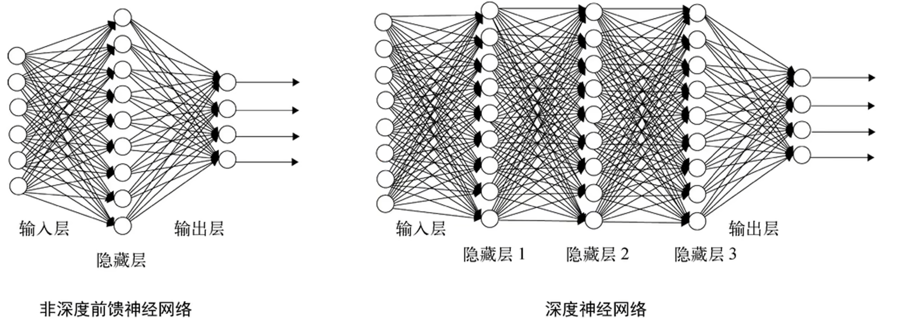

**过拟合（overfitting）**是模型在训练数据上表现很好，但在未见过的验证集、测试集或真实数据上明显变差。训练分数高不等于泛化能力强，应通过独立验证、正则化、早停、数据增强或降低模型复杂度等方法控制。

监督学习的数据带有标签，常见任务包括：

- 回归：预测连续值；
- 分类：预测离散类别。

无监督学习的数据没有目标标签，聚类是典型任务。

## 2. 线性回归

### 2.1 模型

单变量线性回归可写为：

$$
\hat y_i = wx_i + b
$$

多变量形式为：

$$
\hat{\mathbf y} = \mathbf X\mathbf w + b
$$

其中 $\mathbf w$ 是权重，$b$ 是偏置，$y_i$ 是样本真实目标值。可能有多组参数拟合样本，需要用损失函数衡量并选择误差更小的参数。

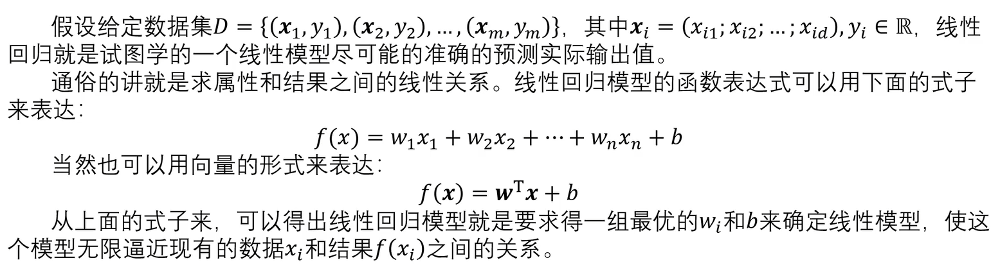

### 2.2 损失函数

均方误差是常见回归损失：

$$
J(\mathbf w,b)=\frac{1}{n}\sum_{i=1}^{n}(\hat y_i-y_i)^2
$$

它把“哪组参数更好”转化为最小化标量函数的问题。

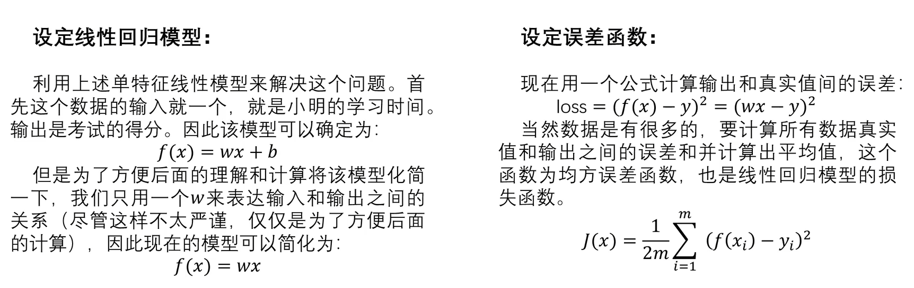

### 2.3 参数求解

#### 穷举

在预设范围内尝试参数并比较损失。它直观但随参数维度和精度迅速变得不可行。

#### 最小二乘解析解

单变量情形可通过二次函数求最小值：

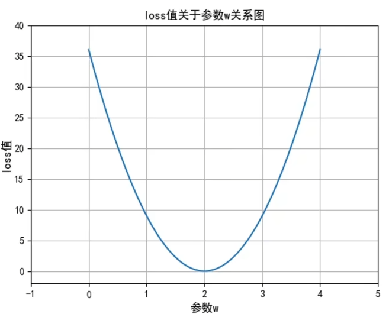

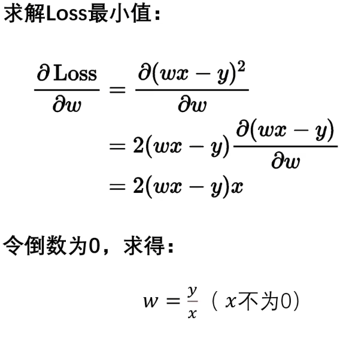

向量形式在满足条件时可写为：

$$
\hat{\mathbf w}=(\mathbf X^T\mathbf X)^{-1}\mathbf X^T\mathbf y
$$

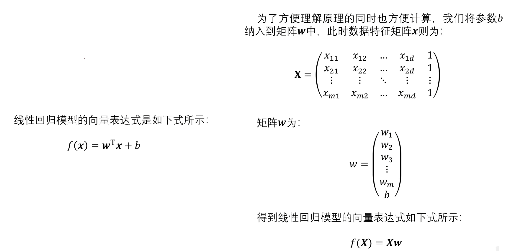

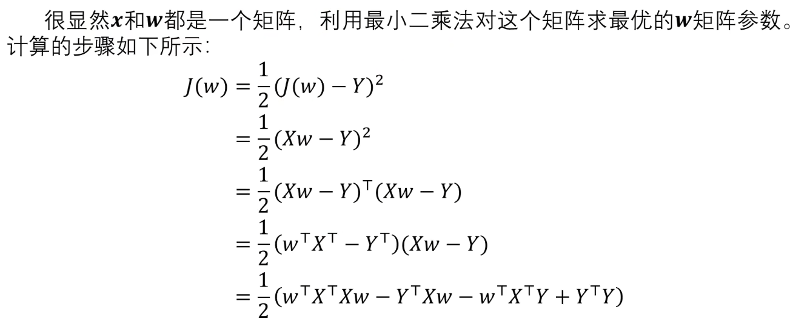

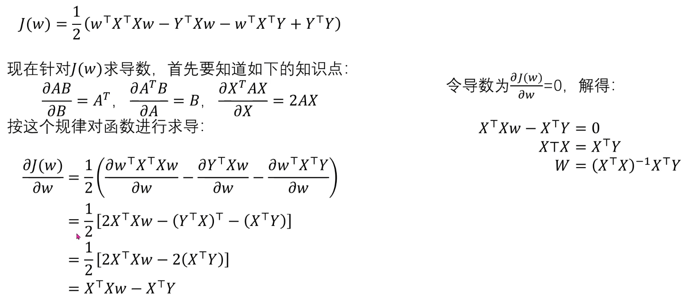

当 $\mathbf X^T\mathbf X$ 不可逆或数值不稳定时，不能直接使用上述逆矩阵形式。实际可使用伪逆、正则化或数值优化，而不是断言最小二乘问题本身一定无解。

#### 梯度下降

梯度指向函数局部上升最快的方向，负梯度用于下降：

$$
\theta_{t+1}=\theta_t-\alpha\nabla_\theta J(\theta_t)
$$

$\alpha$ 是学习率，控制每次更新距离。过大可能震荡或发散，过小则收敛缓慢。多参数模型对各参数求偏导并共同更新。

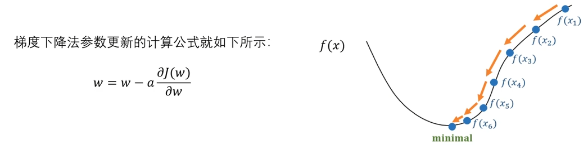

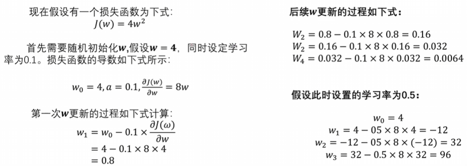

## 3. 逻辑回归

逻辑回归名字中虽有“回归”，通常用于二分类。模型先计算线性组合 $z=\mathbf w^T\mathbf x+b$，再用 sigmoid 映射到 $(0,1)$：

$$
p(y=1\mid\mathbf x)=\sigma(z)=\frac{1}{1+e^{-z}}
$$

根据业务阈值（常见示例为 0.5）把概率转成类别。阈值不是模型固定常数，应根据误报、漏报成本和验证集表现选择。

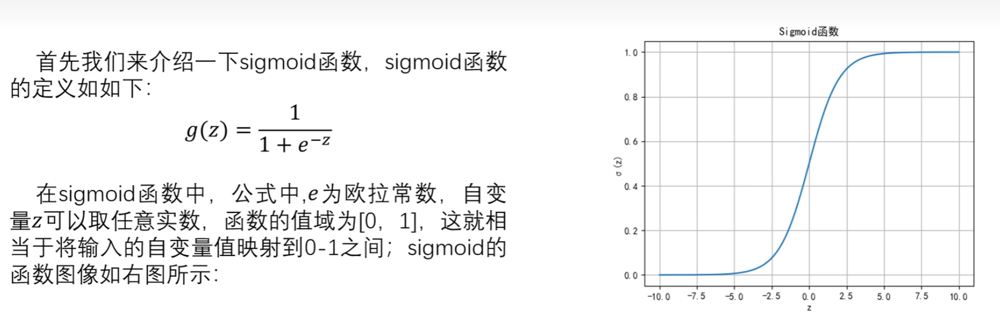

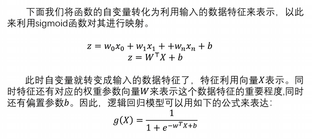

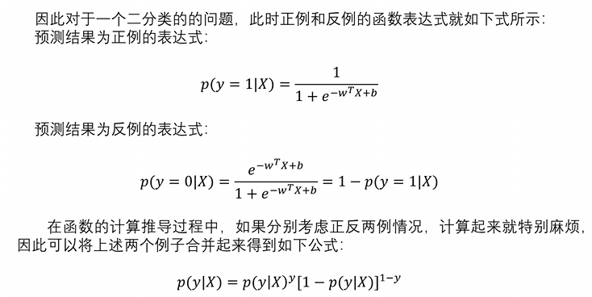

### 3.1 交叉熵损失与参数更新

二分类交叉熵为：

$$
J=-\frac{1}{n}\sum_{i=1}^{n}\left[y_i\ln p_i+(1-y_i)\ln(1-p_i)\right]
$$

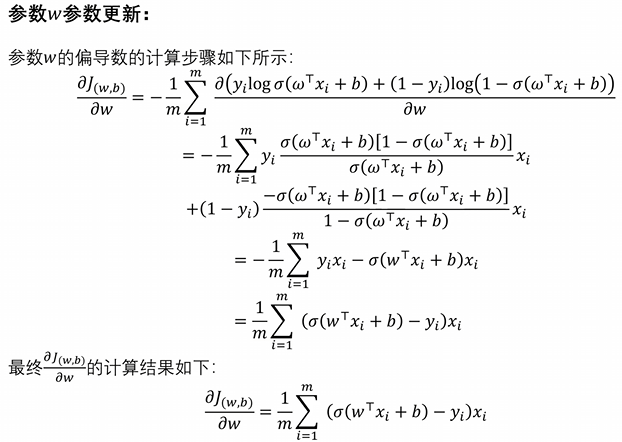

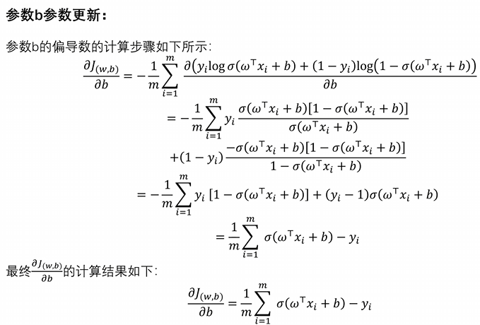

公式中的 `log` 在机器学习资料里通常默认自然对数 $\ln$。若改用其他底数，导数会多一个常数因子；这会影响尺度但不改变最优点，不能仅凭写成 `log` 就忽略底数。

推导参考：[逻辑回归损失函数推导](https://zhuanlan.zhihu.com/p/125753431)

## 4. 统一理解模型训练

1. 数据集包含特征 $\mathbf x$ 与监督标签 $y$；
2. 模型定义特征、参数和预测值之间的函数关系；
3. 不同任务与概率假设对应不同损失函数；
4. 从初始参数出发，利用梯度等优化方法更新 $\mathbf w,b$，使损失逐步降低；
5. 最后使用独立数据和匹配业务目标的指标判断泛化效果，而不是只看训练损失。

## 5. 分类模型评价指标

混淆矩阵中的字母含义：

- `T/F`：预测是否与真实值一致；
- `P/N`：模型预测为正类或负类。

因此：TP 为真正类，TN 为真负类，FP 为假正类，FN 为假负类。

### 5.1 准确率

$$
Accuracy=\frac{TP+TN}{TP+TN+FP+FN}
$$

类别极不平衡时，准确率可能很高却没有业务价值。

### 5.2 精确率

预测为正类的样本中，实际为正类的比例：

$$
Precision=\frac{TP}{TP+FP}
$$

### 5.3 召回率

实际正类中被模型识别出来的比例：

$$
Recall=\frac{TP}{TP+FN}
$$

### 5.4 F1

精确率和召回率的调和平均：

$$
F1=\frac{2\cdot Precision\cdot Recall}{Precision+Recall}
=\frac{2TP}{2TP+FP+FN}
$$

## 6. 回归模型评价指标

### 6.1 平均绝对误差（MAE）

$$
MAE=\frac{1}{n}\sum_{i=1}^{n}|y_i-\hat y_i|
$$

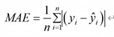

### 6.2 均方误差（MSE）

$$
MSE=\frac{1}{n}\sum_{i=1}^{n}(y_i-\hat y_i)^2
$$

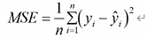

### 6.3 均方根误差（RMSE）

$$
RMSE=\sqrt{MSE}
$$

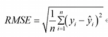

### 6.4 平均绝对百分比误差（MAPE）

$$
MAPE=\frac{100\%}{n}\sum_{i=1}^{n}\left|\frac{y_i-\hat y_i}{y_i}\right|
$$

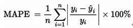

当真实值为 0 或非常接近 0 时，MAPE 无定义或会异常放大，必须采用过滤、平滑或其他指标，不能直接套用。
