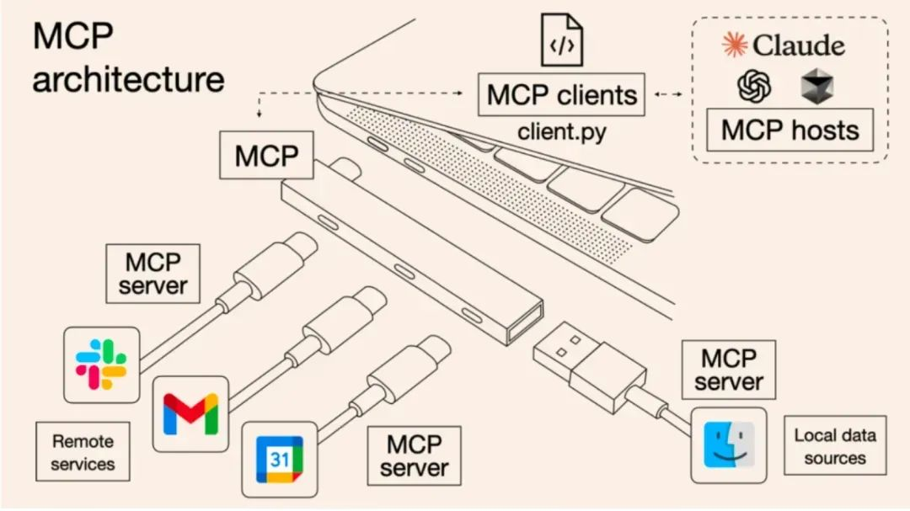
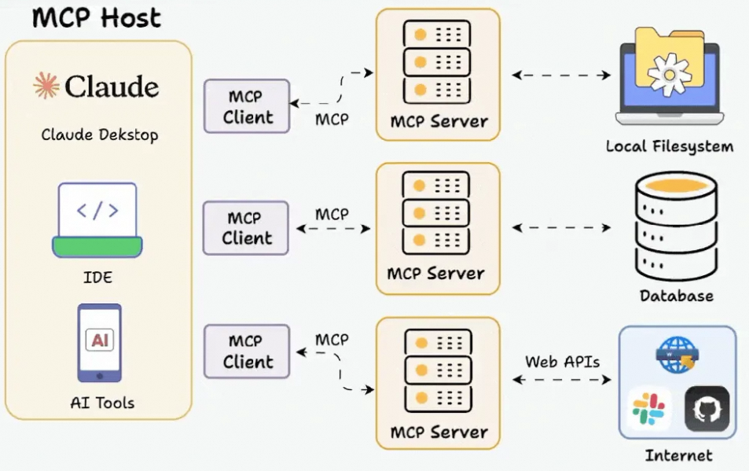

# Function Calling 与 MCP：模型决策和工具接入

## 1. 总体性概念

Function Calling 与 MCP 位于不同层级：

- **Function Calling** 是模型接口层能力：模型根据工具 schema 输出结构化调用意图，包括工具名和参数；
- **MCP（Model Context Protocol）** 是应用协议层标准：Host 通过 Client 发现并调用 MCP Server 提供的工具、资源和 Prompt 模板；
- 二者可以配合：MCP 负责标准化接入，Function Calling 负责让模型选择工具并生成参数。

模型通常不直接执行函数。应用层必须校验请求、执行真实工具、处理副作用，再把结果作为 observation 返回模型。

## 2. Function Calling

### 2.1 工具定义

应用先用 JSON Schema 描述工具的名称、用途和输入参数。下面的 schema 与后续调用严格一致：

```json
{
  "name": "get_weather",
  "description": "查询指定城市和日期的天气",
  "parameters": {
    "type": "object",
    "properties": {
      "city": { "type": "string", "description": "城市名称" },
      "date": { "type": "string", "description": "YYYY-MM-DD" },
      "unit": { "type": "string", "enum": ["celsius", "fahrenheit"] }
    },
    "required": ["city", "date", "unit"],
    "additionalProperties": false
  }
}
```

JSON 本身不支持注释；工具说明应写入 `description`，不要把 `//` 注释放进需要解析的 JSON。

### 2.2 调用闭环

1. 应用把工具 schema 与对话上下文交给模型；
2. 模型判断直接回答还是输出工具调用；
3. 应用校验工具名、参数 schema、权限与风险；
4. 应用执行工具并取得结果；
5. 工具结果以对应的 tool result / observation 回传；
6. 模型基于结果继续调用工具或生成最终回答。

模型可能输出类似意图：

```json
{
  "name": "get_weather",
  "arguments": {
    "city": "上海",
    "date": "2026-02-01",
    "unit": "celsius"
  }
}
```

工具可能返回：

```json
{
  "city": "上海",
  "date": "2026-02-01",
  "condition": "晴",
  "temperature": 25,
  "unit": "celsius"
}
```

不同模型 API 的外层字段名并不统一，不应把某一种 `function_call` 包装格式当成跨平台固定标准；稳定契约应放在工具名、参数 schema、调用 ID 与结果关联上。

## 3. MCP 的目标与边界

MCP 是开放的应用层协议，用于规范 MCP Client 与 MCP Server 之间如何交换外部上下文能力。它不是模型，也不是 Function Calling 的替代品，主要解决每个 AI 应用都要为每个外部系统重复写适配器的问题。

MCP 消息采用 JSON-RPC 2.0 结构。常见传输包括：

- `stdio`：本地进程通过标准输入/输出交换协议消息；
- `Streamable HTTP`：远程服务通过 HTTP 通信。



## 4. Host、Client 与 Server



### 4.1 Host

Host 是集成 MCP 能力的 AI 应用主体，例如桌面助手、IDE 或 Agent 框架。它负责用户与模型交互、安全策略、用户授权和工具注册表，并可管理多个 Client。

Host 先通过 MCP 获得能力描述，再决定怎样暴露给模型：

1. 模型 API 支持 `tools` / Function Calling 时，把 MCP 工具的 `name`、`description`、`inputSchema` 转成模型所需格式；
2. 不支持原生工具调用时，也可以把说明编码进受控上下文并自行解析约定输出。

所以不是 Server 直接告诉 LLM 有哪些工具，而是 Host 负责发现、筛选、转换和授权。

### 4.2 Client

Client 是 Host 内负责协议通信的组件。Host 通常为每个 Server 建立独立 Client 连接。Client 处理初始化、协议版本与能力协商、工具/资源/Prompt 发现、请求发送和结果接收，再把信息交给 Host。

### 4.3 Server

Server 是对接数据库、文件、业务 API 等具体能力的轻量服务。它按 MCP 规范接收请求并返回结果，不需要理解完整对话，也不直接面对模型。

Server 可暴露三类原语：

1. **Tools**：能执行动作或计算的工具；
2. **Resources**：文件、日志等可读取的数据；
3. **Prompts**：可复用、可参数化、有明确用途的提示模板。

MCP Prompt 可以为特定任务提供临时模板，但不应被理解为任意覆盖 Host 的系统安全指令。

## 5. MCP Tool 调用流程

1. Host 按配置连接一个或多个 Server，并创建 Client；
2. Client 发送 `initialize`，协商协议版本与能力；
3. Server 声明是否支持 tools、resources、prompts 等能力；
4. Client 调用 `tools/list` 获取工具列表；
5. Server 返回 `name`、`description`、`inputSchema`，以及可选的 `outputSchema`；
6. Host 汇总、筛选并转换工具定义，建立工具到 Server 的路由；
7. 模型生成结构化工具调用意图；
8. Host 校验后向相应 Server 发送 `tools/call`；
9. Server 执行并返回结果；
10. Host 将结果交回模型，模型继续推理或回答。

### 5.1 消息示例

发现工具：

```json
{
  "jsonrpc": "2.0",
  "id": 1,
  "method": "tools/list"
}
```

Server 返回工具：

```json
{
  "jsonrpc": "2.0",
  "id": 1,
  "result": {
    "tools": [
      {
        "name": "get_weather",
        "description": "查询指定城市的天气",
        "inputSchema": {
          "type": "object",
          "properties": {
            "city": { "type": "string" }
          },
          "required": ["city"]
        }
      }
    ]
  }
}
```

调用工具：

```json
{
  "jsonrpc": "2.0",
  "id": 2,
  "method": "tools/call",
  "params": {
    "name": "get_weather",
    "arguments": { "city": "上海" }
  }
}
```

## 6. 工程约束

- 工具 schema 只描述接口，不能代替服务端校验；
- Host 应只向模型暴露当前用户获准使用的能力；
- 有副作用的工具需要授权、幂等键、超时、重试策略和审计；
- 工具结果是不可信外部输入，不能把其中的文本自动当成更高优先级指令；
- 多个 Server 出现同名工具时，Host 应使用命名空间或显式路由消歧；
- 对远程 Server 要校验身份、连接来源和数据边界。

## 7. 与 LangChain 工具绑定的关系

`@tool` 和 `bind_tools` 是 LangChain 对工具声明与模型绑定的框架封装，详见 `004_LangChain_@tool_与_bind_tools.md`。它们可以绑定本地函数，也可以由应用把 MCP 发现的 schema 转换后绑定；无论哪种方式，最终仍是“模型表达意图，应用执行工具”的闭环。

## 8. 参考资料

- [Model Context Protocol 官方文档](https://modelcontextprotocol.io/docs/getting-started/intro)
- [MCP：一篇就够了](https://zhuanlan.zhihu.com/p/29001189476)
- [一文详解什么是 MCP 以及 MCP 可以做什么](https://blog.csdn.net/m0_56255097/article/details/148785847)
