# 深度学习
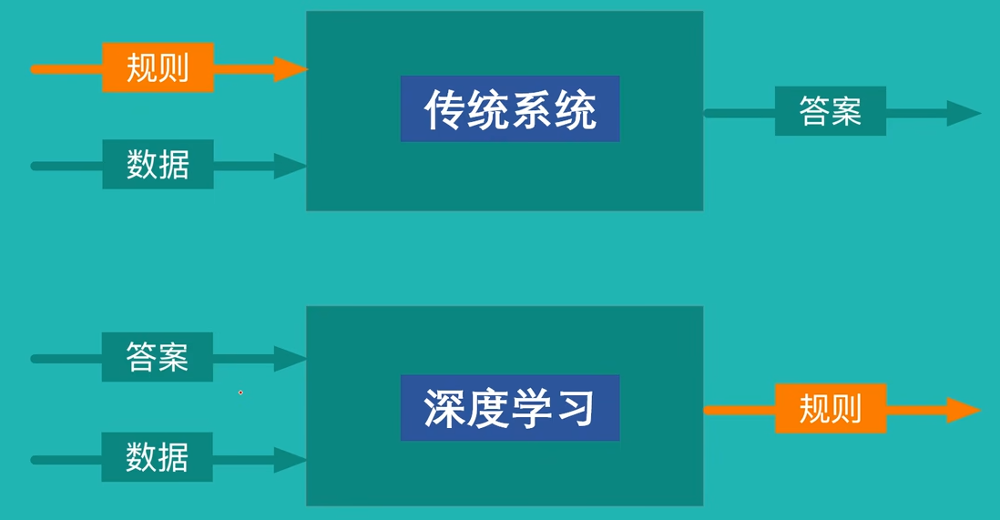
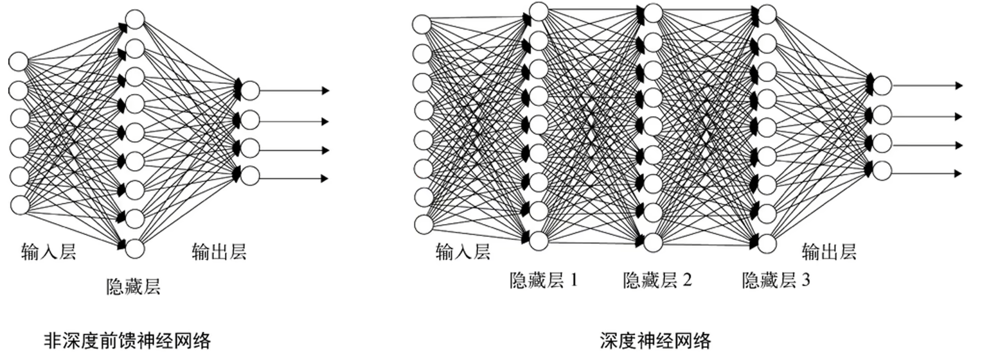
过拟合（offerfitting）：机器学习模型在训练数据上表现很好(比如准确率极高)但在新数据(测试集或实际应用场景)上表现明显下降的现象

### 深度学习框架：Keras+TensorFlow

## 一.线性回归模型&梯度下降法
### 1.线性回归模型定义
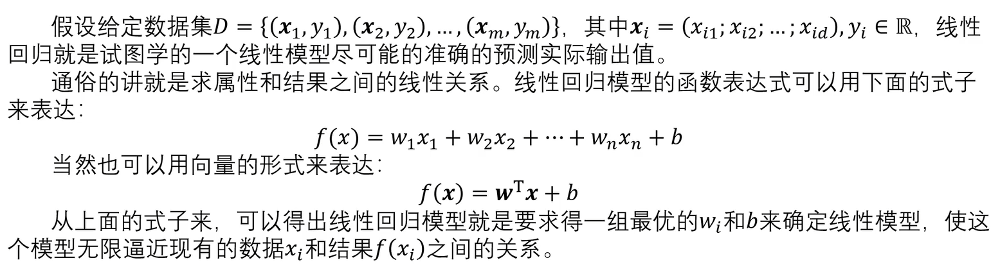
> w~i~为权重参数；b为偏置值
> y~i~为已提供的目标属性样本值
> 实际可能会得到不止一组（**w**,b），那么需要计算和样本间的平均距离，选取损失最小的
### 2.误差函数
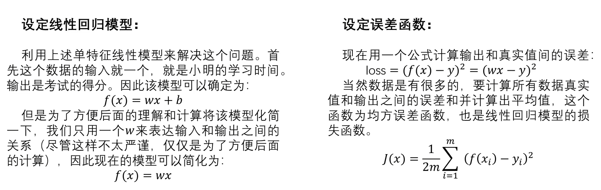
> 用于评判所得到的参数（**w**,b）
### 3.参数求解
#### 1).穷举
#### 2).最小二乘法
##### 非向量形式
二次函数求最小值
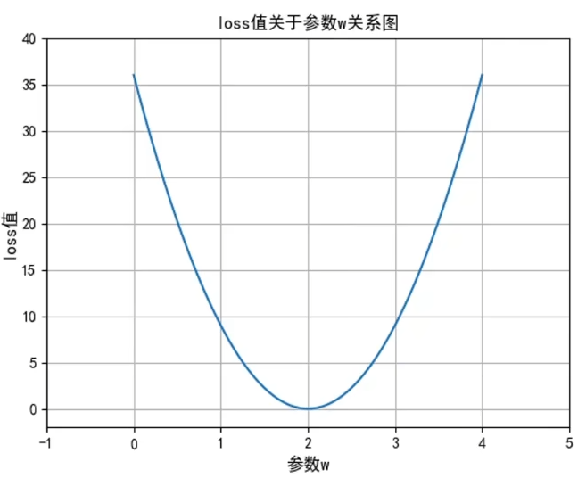
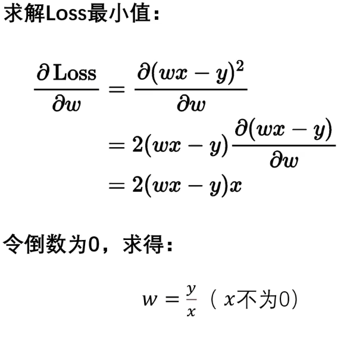
##### 向量形式
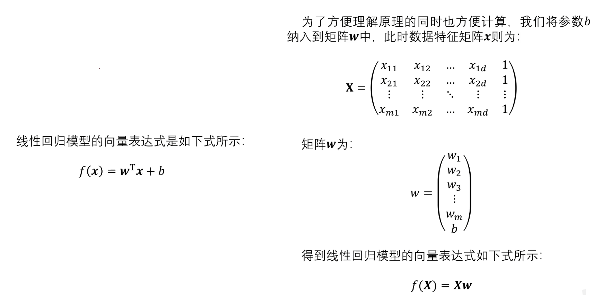
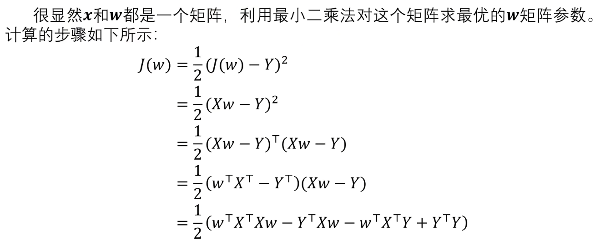
**----矩阵求导----**
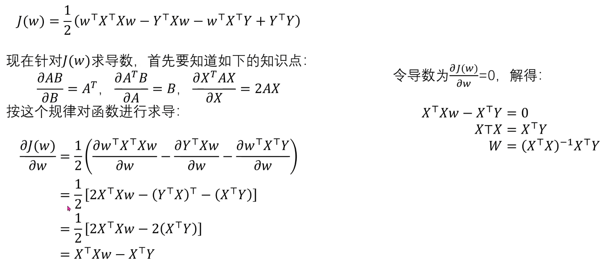 
> 但(X^T^X)^-1^可能无解，所以最小二乘法不一定可以求解
### 4，梯度下降法
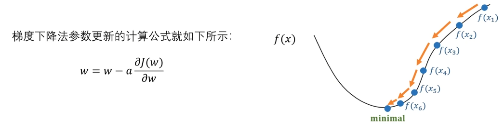
> 求导求出梯度（上升变化最快）取负，也就是确定了下降最快的方向；
> a为参数，控制在上一步确定的方向上移动的距离；
#### 案例
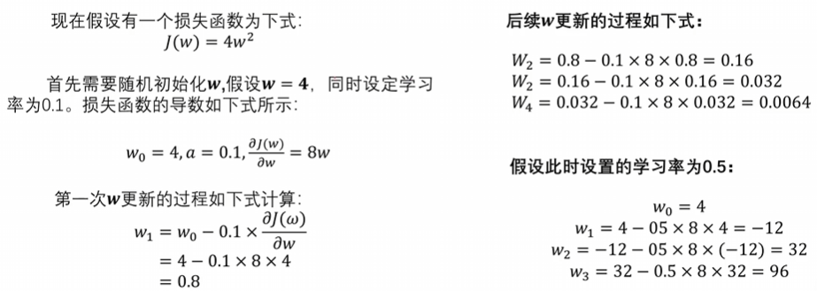
#### 多参数求解
求偏导

---
## 二.逻辑回归
### 1.回归vs分类
1. 有监督学习：数据带标签
   - 回归任务
   - 分类任务
   - 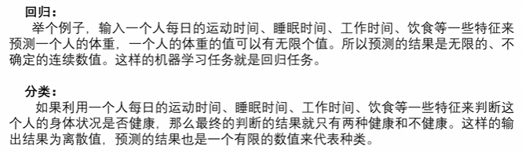
2. 无监督学习：数据不带标签 -> 如 聚类

### 2.算法原理
二分类
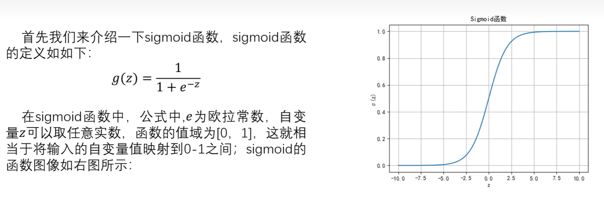
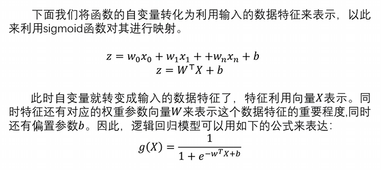
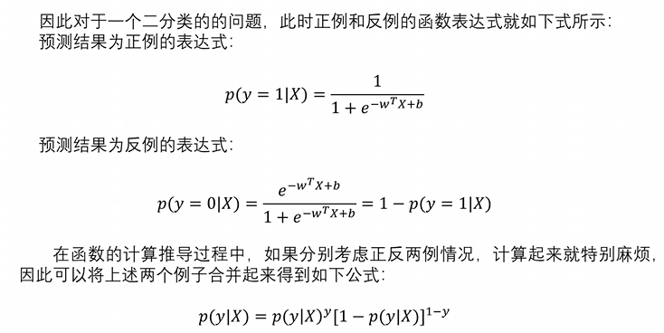
- 因为是做二分类，所以结果y取值为0或1；
- 通过sigmoid函数，根据当前**X**得到(0,1)的映射值p；
- 然后根据映射值p，可以自己设定条件，比如p>0.5时y=1，否则y=0。
### 3.参数更新
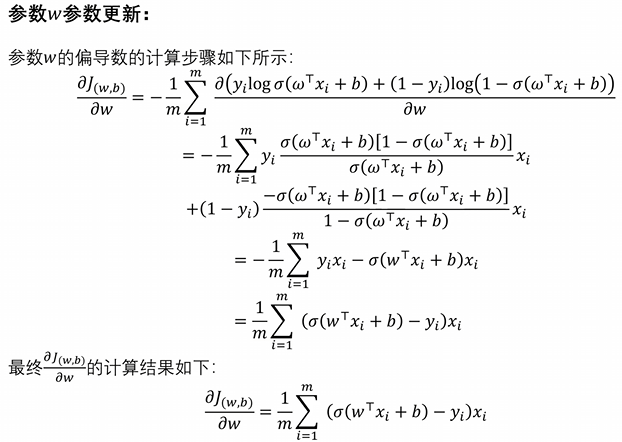
> - 与线性回归的损失函数J(x)=(f(x)-y)^2^不同，此处损失函数为交叉熵损失函数
> - 具体推导：https://zhuanlan.zhihu.com/p/125753431
> - 这里取对数本意是ln，但是写成log，否则求导过程中对数导数不应该是1/(……)的形式

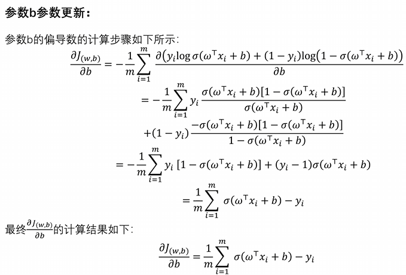

## 小总结
1. 数据集包括数据**x**、数据标签y，最终目的是确定**x**中各分量的权重参数w~i~、配平参数b、；
2. 线性回归和逻辑回归使用不同模型，也就是结果值与**x**、**w**、b的函数关系；
3. 根据不同函数模型又有不同的损失函数；
4. 通过初值，利用损失函数的梯度，由梯度下降原理逐步更改参数**w**、b,逼近损失函数最小值
## 评价指标
### 分类模型评价指标
##### 1.TP TN FP FN
1. T/F:True/False,数据**真实值**与**预测值**是否一致
2. P/N:Positive/Negative，数据**预测值**为正/负
##### 2.准确率
**ACC=( TP + TN )/( TP + TN + FP + FN )**
##### 3.精确
预测出来的正类样本中真正的正类的比例
**P= TP /( TP + FP )**
##### 4.召回率
正类样本中有多少被识别
**召回= TP / ( TP + FN )**
##### 5.F1值
精确率和召回率的调和均值
**F1= 2TP / ( 2TP + FP + FN )**
### 回归模型评价指标
##### 1.平均绝对误差（MAE）
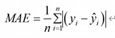
##### 2.均方误差（MSE）
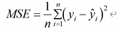
##### 3.均方根误差（RMSE）
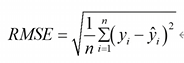
##### 4.平均绝对百分比误差（MAPE）
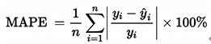