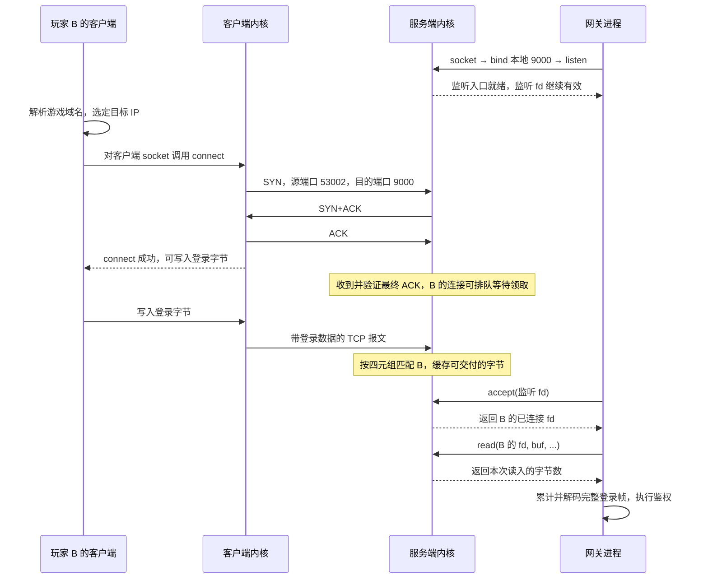

# 01 一次请求如何抵达服务端：从 TCP 端口到 Go 的 Read

2026-11-23 · 网络编程学习记录 · 模块 01，关联模块 02、03、05、06

玩家 A、B 都连接游戏网关的 `9000` 端口。B 先发来一条登录消息。**内核怎么知道这条消息属于 B？网关线程怎么知道现在该读 B？Go 代码又从哪里拿到字节？** 这是三个先后发生的动作，分别涉及 TCP 分用、I/O 就绪通知和应用读取。

下文采用普通 Linux IPv4 TCP，网关地址为 `203.0.113.10`，两个客户端都在 `192.0.2.20` 上。示例省略 NAT、代理和 TLS，假定队列有空间。fd、临时端口和数据长度只用于推演。先看 Linux 接口，再看 Go 如何组合这些接口。

## 1. 报文里有什么，内核里有什么，程序手里又有什么？

| 所在位置 | 概念 | 放进这次登录里理解 |
|---|---|---|
| 物理与链路 | 网口、网线、网卡、帧 | 同一个物理网口能收发很多连接的流量。在以太网上，帧把数据送到当前链路的下一跳。 |
| 网络层 | IP 地址、路由 | IP 包头给出源 IP、目的 IP。发端查路由表，目标在直连链路上时可以直接交给对端，否则通常交给下一跳路由器。这里的默认网关负责转发，游戏网关是最终接收登录消息的应用。 |
| 传输层 | TCP 端口、连接、序号 | TCP 头里有两个 16 位端口，还带有序号、标志位等。TCP 连接是两端共同维护的通信关系，两端各自保存本地状态。 |
| Linux 内核 | socket、连接队列、收发缓冲区 | socket 是一个本地通信端点。对 TCP 来说，内核要记录端点地址、TCP 状态，以及排队的连接或字节。内核的协议代码操作这些状态。 |
| Linux 进程接口 | fd、系统调用、epoll | fd 是当前进程描述符表中的整数，用它引用 socket、epoll 实例等对象。应用以 fd 为参数发起系统调用。TCP 报文里没有 fd。 |
| 执行者与应用 | OS 线程、goroutine、Go 的网络对象 | OS 线程执行代码，goroutine 由 Go 运行时调度。`net.Listener`、`net.Conn` 是业务代码使用的 Go 接口。玩家身份、登录帧格式和鉴权结果由游戏协议定义。 |

**验证“端口属于哪一层”的思考例子。** 在同一台电脑上连 `127.0.0.1:9000`，字节走回环接口，仍然必须用 TCP 目的端口找到服务。换成跨机器连接，网站的 `443` 和游戏的 `9000` 也可以共用一块网卡。端口的值随 TCP 报文传递，物理网口提供传输介质的接口。[TCP 报文头与连接语义 · RFC 9293](https://www.rfc-editor.org/rfc/rfc9293.html)

## 2. 从网关启动到 B 发来登录消息

下图刻意选取“登录字节先到，网关稍后才领取连接”的合法时序。图中只画 B，A 按相同方式接入。系统调用发生在应用与本机内核之间，只有两端内核之间的箭头表示线上 TCP 报文。



1. **网关启动。** `socket()` 创建 TCP 端点并返回监听方稍后会用的 fd。`bind()` 绑定本地 IP 和端口。`listen()` 将这个端点置为 `LISTEN` 状态并返回。此后内核可以持续找到这个监听入口，网关线程可以做其他工作。
2. **客户端决定连哪里。** 游戏配置给出 `gate.example:9000`。客户端解析域名得到候选 IP，有效缓存可以省去一次 DNS 查询。目的端口来自游戏配置。客户端创建自己的 socket 并调用 `connect()`。没有显式绑定时，内核按路由选择源地址并分配临时端口，B 在这里使用 `53002`。
3. **两端内核握手。** 服务端收到新的 SYN，找到匹配的监听 socket，通常为这次握手保留一份轻量请求状态并回复 SYN+ACK。客户端处理 SYN+ACK，发出最后的 ACK，阻塞式 `connect()` 就可以成功返回。服务端处理这个 ACK 后，才在自己这一端完成建连。**客户端返回和服务端收到 ACK 是两个不同的观察点。**
4. **连接可领取。** 普通路径下，服务端为 B 建立完整的 TCP 子连接状态，把这条连接放进监听入口的已完成连接队列。B 的 TCP 数据从这时起可以先存在内核。应用即使晚一点运行，也无须重新握手。
5. **领取与读取。** 网关用 `accept(监听 fd)` 取出一条连接，取得专属于这条连接的新 fd，再用 `read(已连接 fd, …)` 读数据。应用也可以提前调用阻塞的 `accept()`，等队列中有连接时才返回。先发生的是握手完成还是“应用进入 accept”，取决于调用时机；普通路径下，**成功领取**以连接已可领取为前提。[Linux listen(2)](https://man7.org/linux/man-pages/man2/listen.2.html) · [Linux accept(2)](https://man7.org/linux/man-pages/man2/accept.2.html) · [TCP 建连 · RFC 9293](https://www.rfc-editor.org/rfc/rfc9293.html#section-3.5)

## 3. 对象怎样产生，怎样找到，什么时候能拿到 fd？

### 从半连接到应用手里的 socket

| 时点 | 内核新建或修改了什么 | 网关进程此时能操作什么 |
|---|---|---|
| 服务端调用 `socket()` | 创建 socket 及其协议状态，在进程描述符表中建立引用 | 获得 fd，例如 `3` |
| `bind(3, …)`、`listen(3, …)` | 同一个端点取得本地地址，进入监听状态，登记到可供 TCP 查找的监听结构中 | 继续持有 `3`，尚无玩家连接 |
| 匹配到新 SYN | 普通握手路径上创建轻量的 `request_sock`，跟踪握手中的请求 | 仍只有监听 fd 可用，尚不能通过新 fd 读玩家数据 |
| 最后的 ACK 有效 | 产生协议层的子 `sock`，为这条连接维护对端、序号和收发状态；已完成连接等候领取 | 即便应用还没跑到 `accept()`，内核已能匹配这条连接 |
| `accept(3)` 成功返回 | 领取排队的子连接，将它与可由应用访问的 socket、文件对象关联，向进程交付新的 fd | 原 `3` 继续监听；新 fd 只操作这个玩家的连接 |
| 接受第二个玩家 | 为第二条连接重复以上流程 | 使用同一个监听 fd 可多次调用 `accept()`；两个已连接 fd 可独立读写、独立关闭 |

这里要区分两个队列的用途。**握手中的请求**在等对端完成握手；**已完成连接队列**里的连接在等应用调用 `accept()`。两者排的都是建连相关的对象。登录字节则属于某条已建立连接自己的**接收队列**。Linux 的 `listen(backlog)` 针对的是已完成、待应用领取的连接队列，其上限还受系统配置约束。上表采用普通握手路径，SYN cookies 等机制会改变中间请求状态的保存方式。[Linux 建立子连接](https://codebrowser.dev/linux/linux/net/ipv4/tcp_minisocks.c.html#904) · [Linux inet_accept 实现](https://codebrowser.dev/linux/linux/net/ipv4/af_inet.c.html#772) · [Linux listen(2)](https://man7.org/linux/man-pages/man2/listen.2.html)

### 两条查找路径

```text
从网络进入：IP 指明上层是 TCP
              ├─ 已建立连接的报文 → 按两端 IP、端口查找 → 对应 TCP 子连接
              └─ 新 SYN 未匹配既有连接 → 按本地地址和目的端口等匹配监听入口

从应用进入：当前进程的 fd → 描述符表 → struct file → struct socket
                                                  └─ sk → 协议层连接状态
```

Linux 源码里的 `struct socket` 提供通用 socket 接口，含指向协议对象的 `sk`；TCP 所用的协议结构还保存序号、确认进度等信息。**连接在内核可被查找**和**进程已经拿到操作它的 fd**是两个时刻。正因为两条查找路径独立，登录字节才可能早于 `accept()` 返回到达。图中 TCP 分用限定在同一网络命名空间和本例的监听配置。[Linux socket 结构](https://codebrowser.dev/linux/linux/include/linux/net.h.html#socket) · [TCP 协议结构](https://codebrowser.dev/linux/linux/include/linux/tcp.h.html#tcp_sock) · [Linux TCP 查找路径](https://codebrowser.dev/linux/linux/include/net/inet_hashtables.h.html)

### 两个玩家都连上后，数一遍对象

| 网关中的对象 | 进程内 fd 示例 | 本地端点 | 对端端点 | 用法 |
|---|---:|---|---|---|
| 监听 socket | 3 | 203.0.113.10:9000 | 无固定对端 | 继续接入 A、B 之后的新玩家 |
| A 的已连接 socket | 8 | 203.0.113.10:9000 | 192.0.2.20:53001 | 读写 A 的字节流 |
| B 的已连接 socket | 9 | 203.0.113.10:9000 | 192.0.2.20:53002 | 读写 B 的字节流 |
| epoll 实例（若创建） | 5 | 无 | 无 | 可以同时监控 3、8、9 |

在服务端这一侧，表内合计 **1 个服务端口、2 条 TCP 连接、3 个 TCP socket**。第 4 行的 epfd 引用 epoll 实例。TCP 的**四元组**由源 IP、源端口、目的 IP、目的端口组成；从服务端视角也可以统一写成“本地端点 + 对端端点”。A 和 B 的源端口不同，就能区分连接。客户端和服务端各自拥有本地 socket 和 fd，这张表只数服务端一侧。若源 IP 不同，即使源端口相同也能区分。应用侧通过 fd 找 socket；fd 可以在关闭后被复用，因此玩家身份和跨重连的会话还需要应用层管理。

## 4. 阻塞在哪里？非阻塞返回以后，谁决定何时重试？

先看单个系统调用。假设 fd 有效、没有超时或信号，读取长度大于零，连接处于正常状态。

| 当前条件 | 阻塞 socket | 非阻塞 socket |
|---|---|---|
| 已完成连接队列为空，调用 `accept()` | 调用线程可以睡眠，直到有连接可取 | 当次调用立即返回 `-1`，`errno` 为 `EAGAIN` 或 `EWOULDBLOCK` |
| 连接仍开着，没有可读字节，调用 `read()` | 调用线程可以等待数据 | 立即返回暂时无数据的错误，同上 |
| 有 20 字节可读，缓冲区可装 100 字节 | 普通 `read()` 可以直接返回 20 | 同样可以直接返回 20 |
| 对端有序关闭了发送方向，之前的数据已读完 | `read()` 返回 0，表示 EOF | 同样返回 0 |

因此，**阻塞模式描述操作暂时无法推进时允许怎样等**。睡眠的线程不必占用 CPU 空转。同一个线程如果堵在 A 的 `read()` 上，就无法同时执行处理 B 的代码；内核仍可以接收 B 的数据。反之，非阻塞模式只是把“现在没有”告诉调用者，立即反复重试会消耗 CPU。[Linux accept(2)](https://man7.org/linux/man-pages/man2/accept.2.html) · [Linux read(2)](https://man7.org/linux/man-pages/man2/read.2.html)

### 手写 Linux 事件循环：一个线程等多条连接

1. **创建并登记。** 网关准备非阻塞监听 fd `3`。调用 `epoll_create1()` 创建 epoll 实例，取得 `epfd=5`；用 `epoll_ctl(5, ADD, 3, …)` 登记对监听 fd 可读事件的关注。epoll 在内核中维护关注集合和就绪列表。
2. **等新连接。** 网关调用 `epoll_wait(5, events, …, timeout)`。无就绪事件时，`timeout=-1` 可以一直等，`timeout=0` 则立即返回。服务端内核把已完成连接排好队后，监听 fd 就绪；如果线程在等待，内核将它唤醒。**先是原来那次 wait 返回，再由网关代码执行下一次系统调用。**
3. **领取并登记新 fd。** 网关看到监听 fd 可读，主动调用 `accept()`。Linux 上可用 `accept4(..., SOCK_NONBLOCK)` 同时把新 fd 设为非阻塞；普通 `accept()` 返回的 fd 需要单独设置。网关随后用 `epoll_ctl(ADD)` 登记新 fd 的可读事件。接入 A、B 后，同一 epfd 可同时关注 `3、8、9`。
4. **分发就绪事件。** `epoll_wait()` 的参数是一个 epfd，成功时返回就绪事件的条数，具体事件写进 `events[]`，一次可以带回多个 fd 的事件。应用可在登记时把目标 fd 或自己的标识放进事件的 `data`，取回后判断操作。监听 fd 可读时尝试接连接，B 的已连接 fd 可读时尝试 `read(9, buf, …)`。就绪事件只说明值得尝试，实际读取结果可能是字节、EOF 或错误；其他线程抢先读走数据时也可能得到 `EAGAIN`。[Linux epoll(7)](https://man7.org/linux/man-pages/man7/epoll.7.html) · [epoll_ctl(2)](https://man7.org/linux/man-pages/man2/epoll_ctl.2.html) · [epoll_wait(2)](https://man7.org/linux/man-pages/man2/epoll_wait.2.html)

**非阻塞 read 返回了，下一次什么时候调用？** 设 A 的 fd 已登记，网关刚读光 A 的数据，又读一次得到 `EAGAIN`。网关现在可以处理 B；空闲时回到 `epoll_wait()`。A 的新数据到达后，内核把该 fd 标为就绪；线程从 wait 返回，根据事件再次调用 `read(8, …)`。如果数据恰好在两次调用之间到达，默认**水平触发（LT）**下，只要可读条件还在，下一次 wait 就能报告。**边沿触发（ET）**则强调就绪变化；非阻塞读常循环至 `EAGAIN` 再等，避免只取走一部分数据后，剩余数据一直没有新的边沿通知。[Linux epoll 的 LT 与 ET 说明](https://man7.org/linux/man-pages/man7/epoll.7.html)

这几步都能由一个网关线程执行，Linux 的阻塞 `accept()` 自身也可以等待连接。**手写循环中的调用关系是网关先调用 wait，返回后按事件调用 accept 或 read。** socket 提供通信端点，epoll 提供就绪通知，二者没有逐项对应的调用关系。在经典 I/O 模型里，这是同步 I/O 多路复用：线程可以阻塞等待就绪，socket 可以配置为非阻塞，应用仍要主动调用 `read()`，字节才进入自己的 `buf`。

## 5. Go 如何把非阻塞 socket 包装成可以等待的 Accept 和 Read？

以 Linux 上的 Go 1.26.0 标准库为源码参照。沿网关代码看，三行分别操作三种东西：

| Go 调用 | 接收方或返回值 | 实际作用 |
|---|---|---|
| `ln, err := net.Listen("tcp", ":9000")` | 返回 `net.Listener`，本例具体类型为 `*net.TCPListener` | 创建、绑定和监听 TCP socket，交给 Go 网络轮询机制管理 |
| `conn, err := ln.Accept()` | 在同一个监听器上领取一个 `net.Conn`，本例为 `*net.TCPConn` | 每次成功返回一个玩家的已连接 socket 的 Go 包装；继续用同一 `ln` 接其他玩家 |
| `n, err := conn.Read(buf)` | 作用于其中一个玩家的连接 | 取回这条连接的字节，本次有效范围是 `buf[:n]` |

这里写的 `:9000` 表示未指定本地 IP；图表展示一条连接实际使用的 IPv4 服务端地址。示例 fd 编号属于前面的 Linux 推演，Go 的接口没有承诺具体编号。[Go 1.26.0 net 包](https://pkg.go.dev/net@go1.26.0)

```text
业务 goroutine 调用 ln.Accept() 或 conn.Read(buf)
  → 标准库先尝试非阻塞的 accept / read
      ├─ 成功 → 上层方法取得连接 / 字节，可直接返回
      └─ EAGAIN → 通过运行时网络轮询器等待这个 fd 可读
                   → 必要时挂起当前 goroutine，OS 线程可执行其他 goroutine
                   → Linux epoll 报告就绪，等待者恢复为可运行
                   → 获得调度后，标准库重试底层操作
                   → 成功后返回；超时、关闭或出错则按相应结果结束
```

**理解同名调用要看层次。** Linux 的 `accept()` 是系统调用，能单独工作。Go 的 `ln.Accept()` 是标准库方法，可以在一次方法调用期间多次尝试底层操作。`conn.Read()` 同理。某次非阻塞系统调用已经以 `EAGAIN` 返回时，外层 Go 方法仍可能正在等待。运行时统一用 epoll 处理网络就绪；应用无需为每个等待的 goroutine 新建 epoll 实例或专门占住一个 OS 线程。具体到这个版本，创建 TCP 监听 socket 时设置非阻塞模式，完成 `bind → listen` 后将 fd 登记给轮询器。领取连接使用 `accept4`，成功后再为新连接初始化和登记自己的 fd。Go 的 Linux 轮询器使用边沿触发（ET），运行时可以记录先到的就绪状态。goroutine 在决定挂起之前就来了事件，也有机会直接重试。业务层只需调用 `Accept` 或 `Read`，运行时负责协调就绪与调度。[监听 socket 初始化](https://github.com/golang/go/blob/go1.26.0/src/net/sock_posix.go#L150-L179) · [Go 1.26.0 Accept、Read 的等待和重试](https://github.com/golang/go/blob/go1.26.0/src/internal/poll/fd_unix.go) · [Go 1.26.0 Linux epoll 实现](https://github.com/golang/go/blob/go1.26.0/src/runtime/netpoll_epoll.go#L49-L54) · [Go 运行时协调等待与唤醒](https://github.com/golang/go/blob/go1.26.0/src/runtime/netpoll.go#L548-L582)

## 6. TCP 交给网关的是字节，游戏协议才定义一条登录消息

假设 B 一次写入 100 字节的登录帧。服务端第一次 `Read` 可能取到 40 字节，第二次才取齐；一次 `Read` 也可能同时取得上一帧的尾部和下一帧的开头。TCP 提供每条连接上可靠、有序的字节流。应用如果约定“固定长度帧头 + 帧体长度”，就可以累计数据，解析长度，凑齐一帧后交给鉴权逻辑，再接着处理下一帧。UDP 提供数据报边界，协议本身不保证送达或按序到达。[Linux tcp(7)](https://man7.org/linux/man-pages/man7/tcp.7.html) · [Linux udp(7)](https://man7.org/linux/man-pages/man7/udp.7.html)

| 当事方看到的结果 | 当时能确认什么 |
|---|---|
| 客户端 `connect()` 成功 | 本地 TCP 已进入可用的连接状态；服务端进程何时领取连接还要单独观察 |
| 网关 `accept()` 成功 | 网关已拿到一个已连接 fd；登录字节可能还在路上，也可能已经缓存在内核里 |
| epoll 报告已连接 fd 可读 | 可以尝试读取；实际结果由接下来的 `read()` 给出 |
| `Read` 返回 `n > 0` | 应用拿到了这 `n` 个字节；帧是否完整由应用协议判断 |
| 客户端收到并解析鉴权成功响应 | 按游戏协议，才可以把这次登录标记为成功 |

## 7. 本人理解与续接

讨论中已经指出“不同客户端地址和端口可以用来区分连接”。经回环示例厘清，物理网口负责传输，TCP 端口是报文头里的编号。本轮追问也已覆盖监听状态、子连接产生、fd 的交付时机及非阻塞 read 的重试条件。以上时序来自协议、接口文档与源码推演；本轮未做抓包或系统调用跟踪，整条路径待独立复述。

**下次复述题：** 网关已经监听，B 的 `connect()` 成功并发来了登录数据，但网关线程还没调用 `accept()`。请从最后一个 ACK 开始讲到 Go 的 `conn.Read(buf)` 返回，指出过程中**谁用四元组找连接、谁用 fd 找对象、谁负责等就绪**。复述后进入模块 02 的握手、队列与 TCP 状态机。
